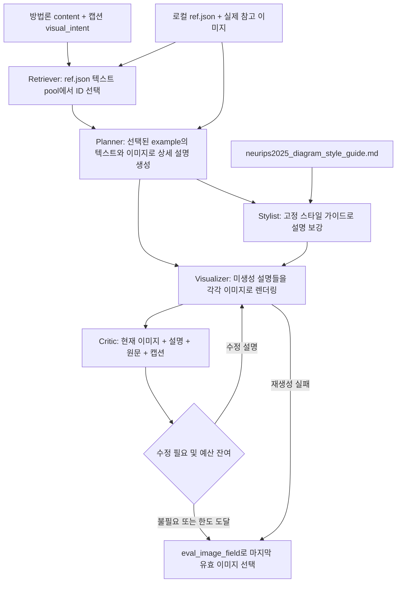
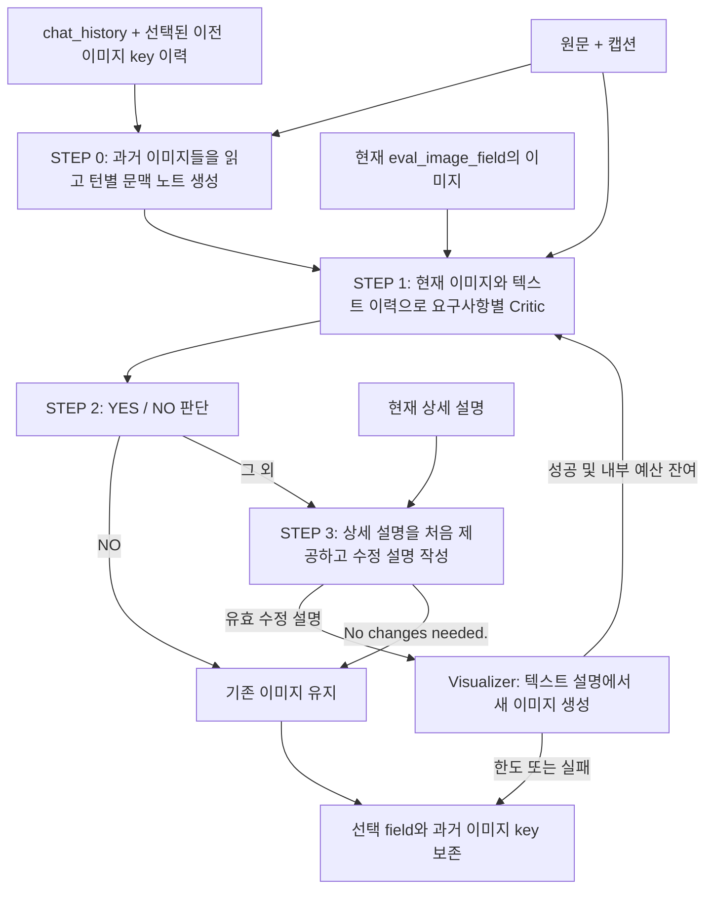

# PaperSketch 원본 구현 분석 및 Codex 스킬 이식 계획

> 최신 구현 상태(2026-11-02): 합의된 로컬 diagram·단일 후보·PBInteract·저장/선택/완료 결과 재개 범위가 연결됨. 원본 파일 30개는 변경 없이 보존되며 회귀 테스트 19개가 통과함. 원본 저장 helper 재사용·폴더 이동 후 재개·실제 후보 생성/피드백 수정·명시적 버전 선택을 확인함. 기본 비율 차이는 UI 21:9로 수정함. auto 전문 관련성·원본 대비 품질 동등성·실제 21:9 출력은 미검증임. 최종 근거는 `review/FINAL_IMPLEMENTATION_AND_SOURCE_AUDIT.ko.md`와 14장임. 아래 최초 분석·중간 단계의 미구현 표기는 당시 상태임.

> 후속 다운로드 완료(2026-11-02): `data/PaperBananaBench/`, `data/MTPaperBananaBench/`에 저장함. 최초 분석 시점의 데이터 부재와 구분 필요함. 전체 `data/`는 Git 추적 제외됨. 출처 revision·검증 결과는 `data/download_manifest.json`에 기록함. PB는 diagram ref/test 298/292개와 plot ref/test 240/240개의 연결 이미지 검증을 통과함. MTP는 ref/test 298/292개를 받았으며 ref 297개와 test 292개의 연결 이미지 검증을 통과함. MTP `ref_309`는 JSON 경로에 U+200C가 포함되어 실제 파일명과 불일치함. 대응 후보 파일은 존재하나 동일성 확정·경로 수정은 미수행 상태임. 두 데이터셋 모두 `ref_260`, `ref_305`의 본문은 비어 있음. 원본은 보존함. 일반 생성·모델 호출 테스트는 미수행임.

- 분석일: 2026-11-02, Asia/Seoul 기준임.
- 범위: 프로젝트 초기화, 로컬 소스 정적 분석, 저장소 간 비교 및 이식 계획 수립까지임.
- 최우선 목표: 원본의 데이터·프롬프트·모델 호출 순서·수정 상태를 추적 가능한 형태로 이식하는 것임. 새로운 그림 생성 알고리즘 설계가 아님.
- 최초 분석 당시 상태: 실제 스킬·실행기 미구현, 전역 설치·설정 변경·모델 다운로드·API 호출·외부 데이터 전송·커밋·업로드 미수행 상태였음. 후속 승인에 따른 구현·다운로드·내장 imagegen 검증은 13·14장에 별도 기록함.

## 1. 결론 및 근거 수준

- **[제안] 주 이식 기준은 PaperBanana-Interact `ed08ef7`의 diagram 초기 생성 + `PBInteract` 반복 수정 흐름임.** 초기 생성부터 실제 사용자 피드백, 이전 요구사항 보존, 턴별 결과 연결까지 같은 데이터 계약으로 연결되어 있기 때문임.
- **[제안] PaperBanana `f1da3db`는 기능별 보완 출처로 사용함.** 데이터 준비기, provider 라우팅, critic 횟수 처리, 출력 선택, plot 실행, 진행 상태 및 관련 테스트를 선별 검토함. Interact 전체를 PaperBanana 코드로 덮어쓰는 방식은 부적절함.
- **[제안] papervizagent `e088a8f`는 원형·출처 대조 기준으로 유지함.** 현재 관심 기능인 다중 턴 문맥화·요구사항별 검토가 없고, 이후 두 저장소에서 개선된 실행 조건이 존재함.
- **[코드] Interact는 PaperBanana의 최신 기능 전체를 포함하지 않음.** diagram 전용 초기 생성과 별도 refiner 구현을 포함하나, PaperBanana의 plot 경로·기존 skill·여러 provider·보조 유틸리티·테스트가 빠져 있음.
- **[미확인] 기능·성능 동등성은 입증되지 않음.** 세 저장소 모두 로컬 참고 데이터셋이 없으며, 실행·이미지 생성·사용자 수정·벤치마크를 수행하지 않았음.

| 표기 | 의미 |
|---|---|
| [코드] | 현재 체크아웃의 소스·설정 템플릿·Git 상태에서 직접 확인한 사실임 |
| [문서] | README 등 저자 설명임. 데이터·논문 결과의 독립 재현을 의미하지 않음 |
| [추론] | 확인된 코드에서 도출한 영향 또는 제약임. 실행으로 확인하지 않은 사항임 |
| [제안] | PaperSketch의 향후 이식·검증 방향임. 구현 완료를 의미하지 않음 |
| [미확인] | 로컬 자료 또는 이번 작업 범위로 확정할 수 없는 사항임 |

## 2. 초기화 및 분석 대상 고정

### 2.1. 프로젝트 루트

- [코드] 시작 시 `C:\WIP\PaperSketch`에는 `reference/`만 존재했으며, 루트 및 상위 경로는 Git 저장소가 아니었음.
- [코드] 루트에서 `git init` 수행함. 기존 중첩 저장소를 이동하거나 submodule로 등록하지 않았음.
- [코드] 기존 루트 `AGENTS.md`, `.gitignore`가 없어 두 파일을 생성함. `.gitignore`에 `reference/`를 추가함.
- [코드] 루트 `AGENTS.md`에 프로젝트 목적, 원본 소스·`.git` 보존, 근거 구분, 현재 단계의 실행 제한을 기록함.
- [코드] 원본 저장소 내부의 추가 `AGENTS.md`는 발견되지 않았음. 사용자 제공 전역 지침과 루트 지침을 적용함.
- [코드] 원격 저장소 생성·추가, commit, push 및 전역 스킬 설치를 수행하지 않았음.

### 2.2. 확인된 HEAD 및 원격 출처

| 약칭 | 로컬 저장소 | 확인한 전체 HEAD | origin | 시작 시 상태 |
|---|---|---|---|---|
| PV | `reference/papervizagent` | `e088a8fff74cc363b6897c0843631fff76484908` | [google-research/papervizagent](https://github.com/google-research/papervizagent) | 작업 트리 변경 없음 |
| PB | `reference/PaperBanana` | `f1da3db8d5f4c3add947dfd3ddd93dddd3394dc3` | [dwzhu-pku/PaperBanana](https://github.com/dwzhu-pku/PaperBanana) | 작업 트리 변경 없음 |
| I | `reference/PaperBanana-Interact` | `ed08ef7e427ce147194af91d8ae6326a6cbc9cbd` | [shirley-wu/PaperBanana-Interact](https://github.com/shirley-wu/PaperBanana-Interact) | 작업 트리 변경 없음 |

- [코드] 세 HEAD 모두 사용자 제시 짧은 커밋과 일치함. PB와 I의 현재 로컬 branch는 `main`임.
- [코드] 로컬 `git log --all`에는 PB의 HEAD 이후 날짜를 가진 다른 ref의 커밋도 표시됨. 이번 분석 대상은 명시한 HEAD이며 다른 ref로 checkout·fetch하지 않았음.
- [코드] PB의 로컬 객체에서 PV HEAD, I의 로컬 객체에서 PB HEAD를 `git cat-file`로 찾을 수 없었음.
- [미확인] 위 결과만으로 실제 개발 계보·공통 조상·fork 시점을 확정할 수 없음. 아래 비교는 현재 체크아웃의 파일·프롬프트 내용 비교에 근거함.

### 2.3. 실제 로컬 준비 상태

| 항목 | PV | PB | I |
|---|---:|---:|---:|
| Git 추적 파일 수 | 37 | 95 | 51 |
| 정적 AST 파싱한 Python 파일 수 | 23 | 48 | 29 |
| AST 문법 오류 | 0 | 0 | 0 |
| `data/` 디렉터리 | 없음 | 없음 | 없음 |
| `configs/model_config.yaml` | 없음 | 없음 | 없음 |

- [코드] 표의 데이터 부재는 각 체크아웃 내부 확인 결과임. 컴퓨터의 다른 위치에 데이터나 인증 정보가 있는지는 조사하지 않았음.
- [미확인] 실제 데이터 row 수, 이미지 무결성, 이미지별 권리, 외부 모델 가용성 및 설치 패키지 호환성은 검증하지 않았음.

## 3. 주요 근거 경로

- 아래 경로는 해당 약칭의 고정 HEAD 기준임. `:숫자`는 분석 시점의 시작 행이며, 함수명과 함께 탐색 가능함.
- 링크는 로컬 원본 소스로 연결됨. 최초 정적 분석에서는 원격·데이터셋 링크에 접속하지 않았음. 후속 사용자 요청으로 확인한 공개 데이터셋 정보는 12장에 별도 기록함.

| 근거 | 파일·함수 및 확인 범위 |
|---|---|
| I1 | [I/app.py](reference/PaperBanana-Interact/app.py):139 `make_processor`, :153 `generate_candidates`, :194 `refine_candidates`, :235 최종 이미지·설명 선택 |
| I2 | [I/app.py](reference/PaperBanana-Interact/app.py):313 `build_app`, :450 `open_session`, :632 `revert_version`, :780 `queue_feedback`, :792 `run_feedback` |
| I3 | [I/utils/paperviz_processor.py](reference/PaperBanana-Interact/utils/paperviz_processor.py):59 초기 critic loop, :119 `process_query_one`, :189 `prepare_retrieval`, :271 `process_single_feedback` |
| I4 | [I/agents/retriever_agent.py](reference/PaperBanana-Interact/agents/retriever_agent.py):31 설정, :47 `process`, :128 `_retrieve_and_parse`, :189 검색 프롬프트 |
| I5 | [I/agents/planner_agent.py](reference/PaperBanana-Interact/agents/planner_agent.py):43 `process`, :120 `DIAGRAM_PLANNER_AGENT_SYSTEM_PROMPT` |
| I6 | [I/agents/stylist_agent.py](reference/PaperBanana-Interact/agents/stylist_agent.py):41 `process`, :87 스타일 프롬프트 |
| I7 | [I/agents/visualizer_agent.py](reference/PaperBanana-Interact/agents/visualizer_agent.py):41 `process`, :146 시스템 프롬프트 |
| I8 | [I/agents/critic_agent.py](reference/PaperBanana-Interact/agents/critic_agent.py):44 `process`, :147 초기 생성 critic 프롬프트 |
| I9 | [I/agents/refiner/pb_interact.py](reference/PaperBanana-Interact/agents/refiner/pb_interact.py):25 텍스트 이력, :48 이미지 이력, :106 `PBInteract.process`, :344 이후 문맥화·두 종류 Critic·gating·rewrite 프롬프트 |
| I10 | [I/agents/refiner/pb_directrefine.py](reference/PaperBanana-Interact/agents/refiner/pb_directrefine.py):51 `process`; [I/agents/refiner/generative_refiner.py](reference/PaperBanana-Interact/agents/refiner/generative_refiner.py):43 `process` |
| I11 | [I/utils/generation_utils.py](reference/PaperBanana-Interact/utils/generation_utils.py):52 설정 우선순위, :110 client 초기화, :193 Gemini 변환, :231 Gemini 호출, :589 OpenAI 이미지 호출, :907 텍스트 router |
| I12 | [I/main_multiturn.py](reference/PaperBanana-Interact/main_multiturn.py):188 CLI, :319 데이터·출력, :362 저장, :403 재개, :447 데이터별 driver |
| I13 | [I/utils/base64_rw_helper.py](reference/PaperBanana-Interact/utils/base64_rw_helper.py):36 쓰기, :67 읽기, :99 재귀 offload |
| I14 | [I/utils/user_simulator.py](reference/PaperBanana-Interact/utils/user_simulator.py):98 피드백 생성; [I/utils/user_simulator_multi_req.py](reference/PaperBanana-Interact/utils/user_simulator_multi_req.py):90 다중 요구사항 simulator |
| I15 | [I/utils/eval_toolkits.py](reference/PaperBanana-Interact/utils/eval_toolkits.py):224 GT 비교, :334 요구사항 응답 파싱, :541 요구사항 평가; [I/prompts/req_eval_prompts.py](reference/PaperBanana-Interact/prompts/req_eval_prompts.py):15 평가 프롬프트 |
| I16 | [I/utils/config.py](reference/PaperBanana-Interact/utils/config.py):25 `ExpConfig`; [I/configs/model_config.template.yaml](reference/PaperBanana-Interact/configs/model_config.template.yaml):18 모델 기본값 |
| P1 | [PB/main.py](reference/PaperBanana/main.py):37 CLI; [PB/utils/paperviz_processor.py](reference/PaperBanana/utils/paperviz_processor.py):271 critic loop, :364 모드 분기, :501 batch |
| P2 | [PB/skill/SKILL.md](reference/PaperBanana/skill/SKILL.md); [PB/skill/run.py](reference/PaperBanana/skill/run.py):51 설정 생성, :214 데이터 준비, :241 출력 선택, :263 실행, :366 CLI |
| P3 | [PB/scripts/prepare_bench.py](reference/PaperBanana/scripts/prepare_bench.py):19 diagram record, :39 plot record, :57 준비기 |
| P4 | [PB/utils/generation_utils.py](reference/PaperBanana/utils/generation_utils.py):69 local prefix, :142 client 설정, :998 이미지 dispatch, :1076 텍스트 router |
| P5 | [PB/agents/planner_agent.py](reference/PaperBanana/agents/planner_agent.py):131 metaphor 분기; [PB/agents/visualizer_agent.py](reference/PaperBanana/agents/visualizer_agent.py):74 렌더링; [PB/utils/plot_execution.py](reference/PaperBanana/utils/plot_execution.py):29 코드 실행 |
| P6 | [PB/utils/critic_rounds.py](reference/PaperBanana/utils/critic_rounds.py); [PB/utils/legacy_ui_results.py](reference/PaperBanana/utils/legacy_ui_results.py); [PB/utils/legacy_generation_options.py](reference/PaperBanana/utils/legacy_generation_options.py) |
| P7 | [PB/app.py](reference/PaperBanana/app.py):108 입력, :174 직접 편집, :829 편집 handler; [PB/demo.py](reference/PaperBanana/demo.py):451 저장 결과 재개 |
| V1 | [PV/main.py](reference/papervizagent/main.py):37 CLI; [PV/utils/paperviz_processor.py](reference/papervizagent/utils/paperviz_processor.py):60 critic loop, :102 모드 분기 |
| V2 | [PV/utils/generation_utils.py](reference/papervizagent/utils/generation_utils.py):52 client 초기화; [PV/agents/visualizer_agent.py](reference/papervizagent/agents/visualizer_agent.py):106 렌더링; [PV/demo.py](reference/papervizagent/demo.py):159 직접 이미지 편집 |

## 4. 최초 그림 생성의 실제 흐름

### 4.1. 입력 경로와 지원 범위

| 경로 | 실제 입력과 다음 호출 | 주의점 |
|---|---|---|
| PV/PB `main.py` | `data/<dataset_name>/<task_name>/<split_name>.json`의 record list → `PaperVizProcessor.process_queries_batch` | `diagram`, `plot` 선택 가능함. `--exp_mode` 기본값 `dev`는 processor의 유효 모드와 맞지 않아 명시적인 모드 지정이 필요함 [V1, P1] |
| PV `demo.py` | Streamlit에서 방법론·캡션·비율·후보 수 → `create_sample_inputs` → batch | 본문을 사용자가 전달하는 경로임. 자동 PDF 파싱 경로가 아님 [V2] |
| PB `app.py`, `demo.py` | Gradio/Streamlit의 방법론 또는 plot raw data·visual intent → task별 입력 정규화 → batch | plot 입력 정규화·출력 선택·크기·진행 상태 개선이 있음 [P6, P7] |
| PB `skill/run.py` | `--content` 또는 UTF-8 `--content-file`, `--caption`, 비율·후보 수 → batch | 기존 Python 실행기이며 Codex 자체 추론으로 단계를 수행하는 구조가 아님 [P2] |
| I `app.py` | 방법론 `method`, 캡션 `caption`, 비율, critic 횟수, 후보 수 → `generate_candidates` → batch, `do_eval=False` | `content`, `visual_intent`, `additional_info.rounded_ratio`, `max_critic_rounds`를 생성함. diagram 전용임 [I1] |
| I `main_multiturn.py` | `data/<dataset_name>/<split_name>.json` → `process_query_one`, `do_eval=True` → 후속 simulator 턴 | `requirements`, `req_order` 필드를 assert함. 기본 dataset은 `MTPaperBananaBench`임 [I12] |

- [코드] 단계별 모델 입력에는 논문 방법론과 그림 캡션/의도가 사용됨. 전체 논문 PDF·참고문헌을 자동 수집·해석하는 기능은 조사한 실행 경로에 없음.
- [코드] I의 여러 docstring에 plot 표현이 남아 있으나, processor와 agent의 실제 task는 `diagram`으로 고정되어 있음 [I3–I8].

### 4.2. 참고 데이터의 구조와 검색

| 항목 | PV/PB | I |
|---|---|---|
| 참고 root | `data/PaperBananaBench/<diagram 또는 plot>/`로 agent 내부에 고정됨 | `ExpConfig.dataset_dir = work_dir/data/dataset_name` 사용함 |
| 자동 검색 pool | `<root>/ref.json` | `<root>/ref.json` |
| 수동 참고 | diagram의 `agent_selected_12.json`에서 앞 10개 사용함 | `<root>/agent_selected_12.json`에서 앞 10개 사용함 |
| 이미지 경로 | `<root>/<record.path_to_gt_image>` | 동일 상대 경로 방식임 |
| 최소 record 계약 | `id`, `content`, `visual_intent`, `path_to_gt_image` | 동일 계약임 |
| `auto` | diagram 앞 200개, plot 전체의 ID·캡션·본문을 한 요청의 후보 pool 텍스트로 전달함 | diagram 앞 200개를 동일 방식으로 전달함 |
| `random` | 전체 pool에서 최대 10개 ID를 무작위 추출함 | 동일 방식임 |
| `none` | ID·example list를 빈 목록으로 설정함 | 동일 방식임 |

- [코드] 검색은 embedding·벡터 DB·웹 이미지 검색이 아님. **LLM이 pool의 텍스트를 보고 `top10_diagrams` 또는 `top10_plots` JSON을 반환하는 선택 방식임** [I4, PB/PV `agents/retriever_agent.py`].
- [코드] Retriever 자체에는 후보 그림 이미지가 전달되지 않음. Planner에서 선택 ID를 실제 record로 연결한 후, 각 example의 본문·캡션·그림 이미지를 함께 전달함 [I5].
- [코드] 검색 기준 프롬프트는 연구 주제와 visual intent의 일치를 사용하며, 두 조건이 동시에 맞지 않으면 시각 구조의 유사성을 우선하도록 지시함 [I4:189].
- [코드] `json_repair`로 결과를 파싱하지만 ID 개수 10개, 중복, pool 소속을 엄격히 검증하지 않음. Planner는 pool에 없는 ID를 건너뜀 [I4:166, I5:68].
- [코드] `auto`·`random`에서 `ref.json`이 없거나 `manual` 파일이 없으면 경고 후 `none`으로 전환함. 선택된 record의 실제 이미지가 없을 때까지 자동 복구하는 기능은 아님 [I4:62].
- [코드] PB/I batch는 첫 record에 대해 검색한 결과를 모든 후보에 공유함. PV는 각 query에서 검색함 [P1:528, I3:189, V1:118].
- **[추론] PB/I의 검색 공유는 같은 요청의 여러 후보에는 적합하나, 서로 다른 논문을 담은 benchmark batch에는 첫 논문의 참고 선택이 공유되는 문제를 유발할 수 있음.** I의 CLI driver도 `prepare_retrieval(data_list)`를 호출함. 향후 이를 수정하면 원본 대비 변경점으로 별도 기록해야 함 [I12:465].
- **[코드] 현재 세 체크아웃에는 데이터가 없으므로 실제 참고 그림 검색은 실행·검증되지 않았음.** README 자산 그림은 참고 pool이 아님.

### 4.3. 모드별 실제 순서

| 모드 | 실제 순서 |
|---|---|
| `vanilla` | 원문·캡션 → Vanilla → 이미지임 |
| `dev_planner` | Retriever → Planner → Visualizer임 |
| `dev_planner_stylist` | Retriever → Planner → Stylist → Visualizer임 |
| `dev_planner_critic`, `demo_planner_critic` | Retriever → Planner → Visualizer → Critic ↔ Visualizer임 |
| `dev_full`, `demo_full` | Retriever → Planner → Stylist → Visualizer → Critic ↔ Visualizer임 |
| `dev_polish` | 별도의 기존/GT 이미지 → 스타일 개선 제안 → 이미지 polish임 |
| `dev_retriever` | Retriever만 수행함 |

- [코드] `demo_*`는 benchmark 평가를 비활성화함. Critic에 의한 생성 검토와 GT 기반 benchmark 평가는 서로 다른 호출임 [I3, P1, V1].
- [코드] 기본 전체 흐름에서 Stylist 이후 Visualizer를 한 번 호출해도, 함수 내부는 아직 이미지가 없는 **Planner 설명과 Stylist 설명을 각각 렌더링함**. 첫 단계 이미지가 항상 1장인 것은 아님 [I7:49, P5:82, V2:114].



### 4.4. 단계별 데이터·프롬프트 계약 — I 기준

| 단계·함수 | 모델에 전달되는 입력 | 프롬프트의 역할 | 출력 및 연결 |
|---|---|---|---|
| `RetrieverAgent.process` | target 방법론·캡션, 최대 200개 후보의 ID·본문·캡션 텍스트 | `DIAGRAM_RETRIEVER_AGENT_SYSTEM_PROMPT`: 유사 도메인·구조의 top 10 선택 | `top10_references: list[str]`, `retrieved_examples`; Planner로 전달함 [I4] |
| `PlannerAgent.process` | 선택 example별 본문·캡션·실제 이미지, target 본문·캡션 | `DIAGRAM_PLANNER_AGENT_SYSTEM_PROMPT`: 구성 요소·연결·배경·색·선·아이콘을 구체적인 그림 설명으로 작성함 | `target_diagram_desc0`; Stylist와 Visualizer의 입력임 [I5] |
| `StylistAgent.process` | Planner 설명, 로컬 diagram 스타일 가이드 전문, 원문·캡션 | `DIAGRAM_STYLIST_AGENT_SYSTEM_PROMPT`: 의미·논리를 유지하며 필요한 미학적 세부사항을 보강함 | `target_diagram_stylist_desc0`; Visualizer 입력임 [I6] |
| `VisualizerAgent.process` | 각 상세 설명을 삽입한 텍스트 프롬프트만 전달함 | 그림 제목 제외 지시가 포함된 render template임. 선택 참고 그림·이전 그림을 이미지 생성기에 직접 전달하지 않음 | `<desc_key>_base64_jpg`; Critic·결과 선택에 사용함 [I7] |
| `CriticAgent.process` | 첫 round는 stylist 또는 planner 설명·이미지, 이후는 직전 critic 설명·이미지, 원문·캡션 | `DIAGRAM_CRITIC_AGENT_SYSTEM_PROMPT`: 내용 충실성·텍스트 오류·예시 정확성·캡션 제외·가독성·legend 검토임 | `target_diagram_critic_suggestionsN`, `target_diagram_critic_descN`; 필요 시 Visualizer로 전달함 [I8] |

- [코드] I의 Retriever/Planner/Stylist/Critic은 기본 `temperature=1.0`, `candidate_count=1`, `max_output_tokens=50000` 설정으로 텍스트 router를 호출함. 여러 후보는 개별 입력 record를 복제하여 생성하는 방식임 [I4–I8, I16].
- [코드] 스타일 가이드는 매 요청에 데이터셋에서 다시 계산하지 않고 Markdown 파일을 읽음. 별도 `style_guides/generate_category_style_guide.py`가 이미지 batch 분석 → 보고서 종합 기능을 제공함.
- [코드] I의 가이드 생성 스크립트는 ref 이미지 앞 50개, batch size 20, 동시성 5, `gemini-3-pro-preview`를 설정함. 현재 포함된 가이드가 정확히 어떤 데이터 revision·실행에서 생성되었는지는 기록만으로 확인되지 않음.
- [추론] 파일명이 NeurIPS인 가이드를 학회의 공식 가이드 또는 전체 참고 데이터에서 매번 자동 도출한 결과로 소개하는 것은 부정확함.

### 4.5. 초기 Critic 반복·생성 조건

- [코드] I `dev_full`의 기본 최대 critic 횟수는 3회이며, record의 `max_critic_rounds`가 config보다 우선함. 0이면 critic loop를 수행하지 않음 [I3:82, :167].
- [코드] I `dev_planner_critic`는 record에 값이 없으면 config 대신 상수 3을 사용함. PB는 해당 분기에서 config를 사용하도록 개선됨 [I3:155, P1:442].
- [코드] `critic_suggestions.strip() == "No changes needed."`이면 추가 이미지 생성 없이 종료함.
- [코드] 재생성 이미지가 유효하게 저장되면 `current_best_image_key`를 갱신하며, 실패하면 직전 유효 이미지로 끝냄. 여기서 best는 별도 선호도 점수로 고른 최적 이미지가 아니라 마지막 유효 이미지임 [I3:76–116].
- [코드] Critic은 이미지가 없으면 text-only 생성 실패 안내를 넣고 설명 수정을 시도함. 잘못된 JSON은 빈 dict로 처리하고 기본 `No changes needed.`로 끝날 수 있음 [I8:86–142].
- [코드] I Visualizer는 생성하지 않은 critic 설명 key를 동적으로 찾으며, `_gen_failed` 표식이 있거나 no-change인 key를 건너뜀. 빈 API 응답은 같은 실패 표식을 남기지 않음 [I7:49–140].
- [추론] 기본 full 흐름, 검색 1회, critic 3회 모두 수정, API 재시도·평가 제외 시 단일 후보는 텍스트 6회와 이미지 5회 호출이 예상됨. 같은 요청 후보 N개라면 텍스트 `1 + N×5`, 이미지 `N×5`임. 이는 코드에서 산출한 호출 수이며 실측 비용·시간이 아님.
- [코드] 마지막 재생성 이미지는 횟수 한도에 도달하면 추가 Critic 없이 반환될 수 있음. 마지막 출력까지 항상 다시 검토된다고 보장할 수 없음.

## 5. 사용자 피드백과 반복 수정

### 5.1. 첫 그림 연결과 UI 상태

- [코드] I `app.py`의 단일 생성 후보에서 Refine을 선택하거나 Iterative Refinement에서 직접 생성하면 `open_session`이 후보 전체 결과와 선택 index를 보존함 [I2].
- [코드] UI 상태는 `versions`, `current`, `pinned`, `chat`으로 구성됨. `versions`의 각 원소는 해당 턴의 `results`와 `exp_mode`를 포함함.
- [코드] `queue_feedback`이 새 user 메시지를 append함. `run_feedback`은 **현재 보고 있는 과거 턴이 아니라 최신 턴의 pinned 후보**를 사용함. 과거 턴에서 분기하려면 먼저 revert가 필요함 [I2:792].
- [코드] `refine_candidates`는 pinned record를 후보 수만큼 deep copy하고, `chat_history`, 최신 `user_input`, 후보 index를 추가함. `process_feedback_batch(simulate_user=False, do_eval=False)`로 전달함 [I1:221].
- [코드] Refiner가 실제로 읽는 새 요청은 `chat_history`의 user content임. 별도 `user_input` 필드가 있다는 사실만으로 입력 연결을 설명하면 불완전함 [I9, I10].
- [코드] I UI 기본 refiner는 `pb_directrefine`, CLI 기본은 `generative`임. **PaperBanana-Interact 방법 자체를 사용할 때는 `pb_interact`를 명시적으로 선택해야 함.** UI 기본 internal round는 1이며 `pb_interact` 선택 시 변경 가능함 [I2:398, I12:281].
- [코드] 정상 UI 처리 후 assistant 안내 메시지와 새 후보 버전을 추가함. 다음 사용자 수정은 새 턴의 pinned 후보에 이어짐.
- [코드] revert는 이후 versions와 chat을 잘라냄. 원본 UI가 모든 분기 이력을 영구 보존하는 구조는 아님 [I2:632].

### 5.2. 공통 feedback processor

- [코드] `process_single_feedback`이 기존 `eval_image_field`를 백업함 [I3:271].
- [코드] `generative`는 refiner가 직접 이미지 생성과 출력 field 갱신을 수행함.
- [코드] `pb_directrefine`·`pb_interact`는 processor가 `current_critic_round=[i,j]`를 설정함. 초기 생성의 round는 int이며, 수정의 바깥 turn `i`는 1부터 증가하고 내부 round `j`는 0부터 시작함.
- [코드] 각 round에서 refiner는 새 설명만 생성함. processor가 no-change이면 멈추고, 그 외에는 `VisualizerAgent.process`를 호출함.
- [코드] 성공 시 `eval_image_field=target_diagram_critic_desc{i}-{j}_base64_jpg`로 갱신함. 생성 실패 시 이전 field를 유지하고 내부 반복을 끝냄.
- [코드] 처리 끝에 기존 이미지 field 이름을 `prior_preferred_candidates`에 추가함. 목록은 이미지 본문이 아니라 과거 선택 이미지의 dictionary key임.
- [코드] 실제 사용자 경로의 바깥 반복은 새 요청이 들어올 때마다 수행됨. UI에 고정된 총 사용자 턴 한도는 없음. 내부 반복은 설정 횟수·no-change·생성 실패로 종료됨.

### 5.3. PBInteract의 실제 모델 호출 순서



| 단계 | 코드·입력 | 출력·중요한 분리 |
|---|---|---|
| STEP 0 문맥화 | `PBInteract.process`의 `j==0`, `format_chat_history_with_images`; 원래 방법론·캡션 + 각 user 발화 + 각 assistant 턴에서 선택된 실제 이미지임 | `target_diagram_contextualize_each_turn_{i}-0` dict임. `context_diagramN`, `context_user_turnN`를 생성함. 첫 internal round에만 호출하며 이후 round에서 재사용함 [I9:133] |
| STEP 1 Critic | 현재 이미지 + 원문·캡션 + 번호가 붙은 text chat + 과거 문맥 노트임 | `critique_latest_turn`, prior turn별 `critique_prior_turnN`, `critique_source_content`, `critique_presentation` JSON임. **현재 상세 설명은 이 단계에 제공하지 않음** [I9:173–270] |
| STEP 2 gating | STEP 1 user 입력과 model 응답을 유지한 같은 모델 대화에 판단 지시를 추가함 | YES/NO 텍스트임. 코드상 소문자화 후 `no`로 시작하면 no-change 처리함. 엄격한 enum 검증은 없음 [I9:272] |
| STEP 3 Refiner | 앞선 Critic·gating 대화 뒤에 현재 상세 설명과 rewrite 지시를 추가함 | `critic_suggestions`, `revised_description` JSON임. 구체적 긍정 서술로 그림 요소·위치·색·관계를 재작성하도록 지시함 [I9:299, :490] |
| Visualizer | rewrite의 상세 설명 텍스트임 | 새 이미지 생성이며, 현재 이미지의 pixel을 입력으로 사용하는 편집 호출이 아님 [I7] |

- [코드] STEP 0은 선택된 과거 이미지들과 현재 이미지로 이력을 다시 문맥화함. 과거 모든 후보 이미지를 보거나 context token 절감을 위해 오래된 대화 자체를 삭제하는 방식은 아님.
- [코드] STEP 1~3은 각각 별도 모델 호출이나, 이전 응답을 `types.Content(role="model")`로 이어 붙인 같은 대화임. 다른 내부 round에는 새 대화를 구성함 [I9:236–319].
- [코드] `j==0`에서는 최신 요구를 아직 반영하지 못한 요청으로 우선 검토함. 과거 요구는 이미 성공한 요소가 유지되는지 별도로 검토함 [I9:366].
- [코드] `j>0`에서는 최신 요구도 이미 수정된 결과에 대해 다른 요구와 함께 재평가함. 사용자가 새 revision을 아직 보지 않았으므로, 더 말하지 않았다는 이유로 충족으로 간주하지 않도록 지시함 [I9:415].
- [코드] 이러한 보존은 프롬프트와 모델 판단에 의존함. pixel 잠금·객체 제약 solver·결정적 요구사항 검증이 아님.
- [코드] `critique_*` 중간 결과와 문맥 dict, 최종 critic suggestions·description은 record에 남음. gating 원문과 STEP 1 원문 전체 대화는 별도 영구 field로 모두 저장되지 않음.
- [추론] 수정이 필요한 첫 internal round는 문맥화 1 + Critic 1 + gating 1 + rewrite 1의 텍스트 4회와 이미지 1회가 필요함. 이후 internal round는 텍스트 3회와 이미지 1회임. no-change이면 rewrite·이미지 호출을 생략함. 실제 수는 재시도와 미생성 key 처리에 따라 달라짐.
- [코드] 원본의 각 역할은 Python 클래스별 독립 agent 또는 동시 subagent 팀과 일치하지 않음. 문맥화·Critic·Refiner 역할 대부분이 `PBInteract.process` 내부의 순차 모델 호출로 구현되어 있음.

### 5.4. 대안 Refiner와 차이

| 방식 | 실제 동작 | PBInteract와의 차이 |
|---|---|---|
| `PBDirectRefine` | 현재 이미지·상세 설명·원문·캡션·텍스트 chat을 한 번에 전달하여 critic suggestions와 수정 설명을 생성함. 이후 Visualizer 호출함 | 이미지 이력 문맥화, 설명을 숨긴 Critic, 별도 gating이 없음 [I10] |
| `GenerativeRefiner` | 현재 이미지 + 원문·캡션 + 전체 텍스트 chat을 이미지 모델에 전달하여 직접 수정함. 결과는 `vanilla_diagram_feedbackN_base64_jpg`임 | 설명문을 거치는 Critic/Refiner 분리가 없음. OpenAI 경로는 코드상 `images.edit`에 기존 이미지를 전달함. 이전 댓글의 text-only 설명과 실제 호출이 다름 [I10, I11:630] |
| PV/PB UI의 직접 편집 | 업로드한 이미지 + edit prompt → 이미지 API → before/after·다운로드임 | full chat·턴별 요구사항 보존·PBInteract 문맥화가 없음. 반복 업로드로 편집할 수 있다는 사실과 다중 턴 알고리즘 구현은 구분이 필요함 [V2, P7] |

### 5.5. benchmark simulator와 실제 사용자 입력의 구분

- [코드] CLI는 첫 그림을 새로 생성하거나 `--load_initial_result`의 record를 `id`로 연결함. `--load_prior_results`는 번호별 JSON에서 연속된 턴을 읽어 마지막 결과 이후부터 재개함. 두 load 옵션은 상호 배타적임 [I12].
- [코드] 단순 이미지 파일만 지정하여 PBInteract를 재개하는 경로가 아님. 최소한 원문·캡션·이미지 field·설명·이미지 key 이력을 갖춘 record 계약이 필요함.
- [코드] simulator는 `req_order` 순서에서 `req_eval_full.status_numerical==0`인 요구를 찾아 짧은 자연어 불만으로 생성함. 다중 요구 버전은 처음 k개를 사용함 [I14].
- [코드] hidden `requirements`와 평가 이유는 simulator·평가기에 사용되며, PBInteract의 생성 프롬프트에는 직접 모두 전달하지 않음. PBInteract는 실제로 드러난 chat 요청을 읽음.
- [코드] 불충족 요구가 없으면 `early_stopped=True`로 반환함. driver는 뒤의 번호별 snapshot도 기록할 수 있으나 실제 수정이 수행된 턴과 구분함.
- [코드] 기본 feedback turn은 5회, 기본 refiner internal round는 1회임. README의 PBInteract 실행 예시는 internal round 10을 명시함. 기본값과 논문/문서 비교 조건을 혼동하면 안 됨 [I12:259, I/README.md:140].
- [코드] 품질 평가는 GT를 먼저 제시한 faithfulness·conciseness·readability·aesthetics 4개 모델 판단과 tier 기반 overall 계산임. 요구사항 평가는 별도 호출임 [I15].
- [코드] 평가 모델 기본값은 함수의 `gemini-3.1-pro-preview`임. processor가 main model 설정을 evaluator 인자로 넘기지 않으므로 생성 모델 변경이 평가 모델 변경을 뜻하지 않음.
- [코드] 요구사항 평가는 strict alignment를 최대 3번 시도한 뒤 soft matching을 1번 시도함. 파싱 실패를 0으로 처리하는 경로가 존재하므로 점수와 평가 실패율을 함께 확인해야 함 [I15:541].
- [문서] README의 292 diagrams·3,518 requirements·성능 향상 수치는 저자 보고임. 로컬 데이터·논문 실험을 확인하지 않아 이번 분석의 실측 결과가 아님.

## 6. 모델 라우터·API·저장 방식

### 6.1. provider와 모델 설정

| 구분 | PV | PB | I |
|---|---|---|---|
| 모델 설정명 | `model_name`, `image_model_name` | `main_model_name`, `image_gen_model_name` | PB와 같은 이름임 |
| 텍스트 호출 | 핵심 4개 agent가 `call_gemini_with_retry_async`를 직접 호출함 | `call_model_with_retry_async`로 통합함 | 같은 이름의 router이나 다중 턴 옵션이 추가됨 |
| 외부 provider | Gemini/Vertex 중심, 별도 Claude Vertex·OpenAI helper 존재함 | Gemini, Anthropic, OpenAI, OpenRouter, OrcaRouter, Atlas Cloud, local/Ollama 텍스트 경로임 | Gemini/API key 또는 Vertex, Anthropic, OpenAI, OpenRouter임 |
| 이미지 분기 | Gemini 또는 `gpt-image`임 | `dispatch_image_generation`: gpt-image → OpenRouter → OrcaRouter → Gemini임 | Visualizer: gpt-image → OpenRouter key 존재 → Gemini임 |
| plot | matplotlib 코드 생성·실행 지원함 | 코드 생성·공용 실행기·정규화가 개선됨 | diagram 전용임 |

- [코드] PB 텍스트 router는 명시 prefix를 우선하고, 그 외에는 OpenRouter → OrcaRouter → Gemini → Anthropic → OpenAI client 순서로 선택함. `atlas/`, `local/`, `ollama/`는 명시 선택 경로이며 local/Ollama는 이미지 생성 경로에서 거부함 [P4].
- [코드] I 텍스트 router는 `openrouter/`, `claude-`, `gpt-/o1-/o3-/o4-`를 우선하고, 그 외에는 OpenRouter → Gemini/Vertex → Anthropic → OpenAI 순서임 [I11:907].
- **[코드] I router의 Gemini 외 provider 분기에는 `assert not multiturn_input`가 있음. PBInteract STEP 1~3은 `multiturn_input=True`를 사용하므로 현재 구현에서 Gemini 경로가 필요함.** OpenRouter key가 함께 있으면 bare Gemini 이름도 OpenRouter로 선택되어 이 제약에 걸릴 수 있음 [I9:248, I11:937–968].
- [코드] I 인증 정보 우선순위는 요청 ContextVar override → 환경변수 → YAML임. Gradio에서는 google key override를 설정함. 모델명은 명시 인자 → YAML → 환경변수 → 하드 기본값 순서임 [I11:52, I16].
- [코드] I image model 기본값은 진입점에 따라 다름. UI/CLI는 `gemini-3-pro-image`, YAML 템플릿은 `gemini-3.1-flash-image-preview`, config 자체 최후 fallback은 `gemini-3.1-flash-image`임. 어느 값으로 실행했는지 기록이 필요함.
- [코드] I Visualizer의 Gemini 호출은 `response_modalities=["IMAGE"]`, 기본 `1k`, 비율 기본 `1:1` 또는 record의 `rounded_ratio`를 전달함. 이 분기의 `gen_config_args`에는 선언된 Visualizer 시스템 프롬프트가 삽입되지 않음. OpenRouter에는 해당 시스템 프롬프트를 별도로 전달함 [I7:77–126].
- [코드] gpt-image 경로의 출력 설정은 1536×1024, quality high, opaque, PNG임. Gemini의 임의 비율·크기 옵션과 동일한 계약이 아님.
- [코드] I Gemini wrapper는 caller의 5회 설정을 config의 8회 기본 최소치까지 올리며, SDK retry 옵션·jitter backoff도 적용함. `_GLOBAL_API_SEM`으로 텍스트·이미지 호출 수를 제한함 [I11:98, :177, :250].
- [추론] API 재시도 횟수, 내부 critic round, 사용자 feedback turn은 서로 다른 예산임. Codex 이식에서도 하나의 반복 횟수로 합치면 안 됨.
- [미확인] 코드에 적힌 모델명이 현재 각 provider에서 유효한지, SDK가 해당 옵션을 받는지, 실제 비용·지연이 얼마인지는 확인하지 않았음.

### 6.2. 저장·재개

| 실행 경로 | 저장 방식 | 보존 범위·제약 |
|---|---|---|
| PV/PB benchmark CLI | `results/<dataset>_<task>/<exp_name>.json`에 전체 record list를 주기적으로 다시 기록함 | 설명·참고 ID·critic 결과·base64 이미지·평가 결과 포함함 |
| PB UI | `results/demo/` JSON·이미지 다운로드, Streamlit의 저장 JSON 재로딩 기능임 | 저장 결과 재표시와 PBInteract의 chat 기반 재개는 별개임 [P7] |
| PB skill | 지정 PNG 또는 후보별 `<stem>_N.png`, 저장 경로 stdout 출력임 | `run.py` 자체에는 전체 중간 record·chat 이력의 JSON 저장·수정 재개가 없음 [P2:334] |
| I benchmark CLI | `results/<dataset>/<timestamp_uuid_...>/config.json`, `0.json`, `1.json` 등임 | 결과의 base64 field를 `base64/<sha256>` 파일로 offload함. 파일 내용은 이미지 binary가 아닌 base64 텍스트임 [I12, I13] |
| I Gradio | `gr.State`의 버전·chat·pinned 상태 및 임시 PNG 다운로드임 | 전체 세션을 JSON으로 영구 저장하고 재로딩하는 UI 경로는 확인되지 않음. 프로세스 재시작 시 복구를 보장하지 않음 [I1, I2] |

- [코드] I의 `eval_image_field`는 최종 이미지 값을 담은 다른 field의 이름임. 이미지 field 값은 raw base64이거나 실제 base64 텍스트 파일의 절대 경로일 수 있으며, `read_base64`로 해석함 [I13].
- [추론] offload JSON의 절대 경로만 복사하면 다른 컴퓨터에서 복구되지 않음. image blob과 경로 재연결 검증이 필요함.
- [코드] 모든 renderer의 일반 결과는 JPEG base64로 변환됨. 이후 PNG로 저장해도 원래 모델의 PNG·투명도·압축 전 pixel을 복원하는 것은 아님.

### 6.3. 원본 실행에 추가로 필요한 조건

- [코드] 원본 실행에는 Python 및 `google-genai`, Pillow, `json_repair`, YAML, 비동기 IO 등의 패키지가 필요함. 원본 provider를 유지하면 해당 SDK와 인증 정보·네트워크가 추가로 필요함. 로컬 가중치 다운로드를 필수로 하는 구조는 아님.
- [문서] PB requirements는 Python 3.12를 기준으로 provider·이미지·UI 패키지의 최소 버전을 적고 있음. I README도 Python 3.12 환경을 제시함. 설치나 호환성 실험은 수행하지 않았음.
- [코드] I는 `gradio>=6.0.0,<7`을 지정하며, PB는 `gradio>=5.0.0`을 지정함. I의 여러 provider SDK는 버전이 고정되지 않음. 환경을 하나로 합칠 수 있다고 가정하지 않음.
- [코드] PB Parquet 준비기는 `huggingface_hub`, `pyarrow`가 필요함. I는 별도 dataset clone layout을 요구하며 PB 준비기를 호출하지 않음.
- [코드] 세 저장소의 generation utility는 import 시 client 초기화 코드가 실행될 수 있음. PV는 `google.auth.default()`도 호출하며, `utils/config.py:45`의 `time.tzset()`은 Windows guard가 없음. PB/I에는 해당 guard가 있음.
- [제안] 후속 원본 실행은 원본 checkout을 유지한 채 별도 복사본·결과 경로·분리 환경에서 진행함. 현재 단계에서는 SDK import·인증 탐색·모델 실행을 피한 정적 분석만 수행함.

## 7. 세 저장소 비교와 기능 차이

### 7.1. 파일·프롬프트 내용 대조

- [코드] `git ls-files`로 추적 파일을 열거한 뒤 SHA-256으로 같은 상대 경로의 파일을 비교함. 원본 모듈을 import하지 않았음.

| 비교 | 공통 상대 경로 수 | byte 동일 파일 수 | 해석 |
|---|---:|---:|---|
| PV ↔ PB | 37 | 17 | PV 추적 경로 전체가 PB에도 있음. 후속 변경·추가 파일이 존재함 |
| PV ↔ I | 26 | 2 | byte 동일 2개는 diagram·plot 스타일 가이드임 |
| PB ↔ I | 28 | 2 | byte 동일 2개는 같은 스타일 가이드임. 공통 구조가 없다는 뜻은 아님 |

- [코드] PB와 PV의 `BaseAgent`, diagram/plot 평가 prompt 파일, `eval_toolkits.py`, 두 스타일 가이드는 byte 동일함.
- [코드] AST로 추출한 diagram 핵심 프롬프트 문자열은 세 저장소에서 모두 동일함. 파일 전체 hash 차이는 모델 설정명·호출 방식·task 범위·라이선스 URL 등의 차이도 포함하므로 prompt 변경과 구분함.

| diagram prompt | 세 저장소에서 동일한 문자열 SHA-256 앞 12자리 |
|---|---|
| Planner 기본 | `b3fc12a758ae` |
| Retriever | `5ed3419b658e` |
| Stylist | `28413ec198ec` |
| 초기 Critic | `0635787a9a08` |
| Visualizer | `8e8e7d19ece3` |

- [코드] PB/PV의 plot Planner·Retriever·Stylist·Critic·Visualizer 문자열도 각각 동일함. PB는 diagram Planner에만 선택적인 metaphor supplement를 추가함. I에는 plot prompt/실행 경로가 없음.

### 7.2. 기능 비교

| 기능 | PV | PB | I | 이식 판단 |
|---|---|---|---|---|
| 원형 5단계 diagram 생성 | 있음 | 있음 | 있음 | I 기준으로 데이터 계약 유지함 |
| 참고 그림 선택 및 Planner few-shot | 있음 | 있음 | 있음 | I dataset root를 유지하고 실제 데이터 연결을 필수 검증함 |
| plot 코드 생성 | 있음 | 있음, 공용 실행기 개선 | 없음 | 별도 task 범위로 PB 기준 검토함 |
| Visualizer critic key 범위 | `range(3)` 고정 | 설정 횟수와 숫자 key helper 사용 | 동적 key 검색, `i-j`도 처리 | I의 수정 key 계약 유지가 필요함 |
| critic 0회·설정 반영 | 일부 분기 불일치 | 보완 및 테스트 존재 | planner-critic fallback 불일치 잔존 | PB의 관련 보완만 선별함 |
| batch 검색 재사용 | query마다 수행 | 첫 record 결과 공유 | 첫 record 결과 공유 | 같은 요청 후보와 서로 다른 논문의 구분 필요함 |
| 별도 이미지 직접 편집 UI | 있음 | 있음, provider·JPEG encoding 보완 | GenerativeRefiner 대안 존재 | 주 PBInteract 알고리즘과 분리함 |
| 문맥화 + 요구별 Critic + gating + rewrite | 없음 | 없음 | `PBInteract`에 있음 | 주 이식 대상임 |
| user simulator·hidden requirements 평가 | 없음 | 없음 | 있음 | 사용자 스킬 실행과 분리된 검증 경로로 유지함 |
| 턴별 JSON 재개·base64 중복 제거 | 없음 | 단일 생성 결과 재표시 중심 | 있음 | I의 상태·저장 계약을 이식하되 경로를 수정함 |
| 기존 skill 지침·CLI | 없음 | 있음 | 없음 | 참고할 래퍼이며 그대로 설치하지 않음 |
| provider·로컬 텍스트 라우팅 | 제한적 | 가장 넓음 | 범위가 다름, PBInteract는 Gemini 다중 턴 제약 | 목적에 필요한 backend만 선택함 |
| 테스트 | `tests/` 없음 | 18개 Python test 파일 존재 | `tests/` 없음 | 선별 재사용 및 I 흐름 테스트 추가가 필요함 |

### 7.3. PB 기존 skill의 역할과 한계

- [코드] `skill/SKILL.md`는 설치 명령·API key·CLI 사용법·파라미터를 안내함. ClawHub 게시를 설명하며, 각 단계를 Codex 추론으로 치환하는 지침이 아님 [P2].
- [코드] `skill/run.py`는 config template 복사 → 데이터 확보 → agent 생성 → 후보별 full pipeline → 최종 이미지 추출 → PNG 저장을 수행하는 Python 래퍼임.
- [코드] `ensure_dataset`은 데이터가 없으면 Hugging Face의 `dwzhu/PaperBananaBench` Parquet를 다운로드하고 JSON·이미지 layout을 준비함. `ref.json`과 `images/` 존재만으로 usable을 판정하며 각 이미지 무결성까지 확인하지 않음 [P2:69, P3].
- [코드] `--retrieval-setting none`이어도 `run`은 먼저 `ensure_dataset`을 호출함. 이번 범위에서 실행하면 금지된 다운로드·원본 폴더 쓰기·외부 모델 호출로 이어질 수 있어 실행하지 않았음.
- [코드] parser는 `--task plot`을 허용하나 `run`이 `ExpConfig.task_name`에 값을 넘기지 않아 diagram 기본값을 사용함. 최종 이미지 추출도 diagram key로 고정되어 있음. plot 데이터를 확보하는 것과 plot 경로가 끝까지 연결되는 것은 다름 [P2:263, :377].
- [코드] skill에는 user feedback·chat·과거 이미지 field·`PBInteract` 호출이 없음. 단일 생성 결과 PNG만으로 전체 수정 계약이 갖춰지지 않음.
- [추론] 따라서 기존 skill을 복사한 뒤 이름만 바꾸는 방식은 요구한 전체 흐름의 이식이 아님.

### 7.4. 선별 도입 후보

- [제안] PB `critic_rounds.py`의 기본값·0회 처리 및 관련 테스트를 초기 생성에 반영하는 방안을 검토함. 단, 숫자 suffix만 인식하는 `critic_round_indexes`는 I의 `i-j` 수정 key를 그대로 지원하지 않으므로 별도 연결이 필요함.
- [제안] PB `prepare_bench.py`는 PaperBananaBench 확보·변환에 재사용 가능함. MTPaperBananaBench 전용 downloader로 사용하면 안 됨. data revision 명시 및 각 record 이미지 검사 보완이 필요함.
- [제안] PB provider adapter는 외부 원본 backend 유지 시 선택적으로 검토함. I의 `multiturn_input` 옵션·model role·context override를 보존하지 않고 통째로 교체하면 PBInteract 호출 계약이 깨짐.
- [제안] PB plot 실행·UI 결과 resolver·이미지 size·저장 결과 재표시는 별도 필요성이 확정될 때 선별함. metaphor 옵션은 기본 off를 유지하여 원래 Planner의 동작 변경을 방지함.

## 8. Codex 스킬 이식 계획

### 8.1. 기준선과 실행 방식

- [사용자 확정] 원본 Python 에이전트·processor·프롬프트 구성·반복 제어·상태 관리를 최대한 재사용하고, 텍스트 모델 호출을 Codex로, 이미지 모델 호출을 Codex imagegen으로 연결하는 방식이 우선임. 원본 동작을 먼저 스킬로 연결하여 테스트하고, 확인된 문제만 후속 수정하는 순서임.
- [제안] 아래 대응표에서 Codex가 추론을 수행한다는 설명은 원본 에이전트를 지침으로 새로 구현한다는 뜻이 아님. 원본 함수가 구성한 요청을 Codex에 전달하고, 결과를 원본의 반환 계약으로 돌려주는 호출 adapter를 의미함. Python과 host 도구 사이의 실제 연결 방식은 구현 전 검증이 필요함.
- [제안] 먼저 **I의 단계·입력·프롬프트·출력·종료 조건을 보존한 기준선**을 정의함. Codex용 변경은 해당 단계에 대한 adapter로 기록함.
- [제안] 원본 API backend를 유지한 비교 실행과 Codex 추론·이미지 도구로 바꾼 실행을 구분함. 두 backend를 모두 제품 기능으로 일반화하는 대규모 framework를 먼저 만들 필요는 없음. 비교용 원본 실행은 고정 소스의 별도 작업 복사본으로도 충분함.
- [제안] `SKILL.md`는 재사용한 원본 실행기를 시작·재개하고 모델 요청을 처리하는 방법을 안내함. 원문 prompt는 가능한 한 기존 agent 코드에 유지하고, style guide·데이터·이력 처리도 기존 코드를 우선 사용함. adapter에 필요한 변환·파일 연결만 보완함.
- [제안] main 경로에서 **텍스트 설명 기반 재생성**을 유지함. 이전 이미지를 imagegen 편집 입력으로 넣는 방식은 `GenerativeRefiner` 대안과 대응시키거나 명시적 실험 변경으로만 취급함.
- [미확인] 이번 계획은 현재 세션에 노출된 파일 읽기·로컬 코드 실행·이미지 생성/편집 도구의 계약을 바탕으로 한 가능성 검토임. 모든 Codex 배포 환경에 같은 도구가 존재한다고 보장하지 않음. 공개 문서 최신 조회·계정별 접근 검증은 외부 통신 제한에 따라 수행하지 않았음.

### 8.2. 원본 기능별 대응표

| 원본 기능·코드 | 원본의 동작 | Codex 이식 방법 | 유지·변경 사항 | 의존성·제약 | 검증 방법 |
|---|---|---|---|---|---|
| I `app.generate_candidates`, 입력 record [I1] | 방법론·캡션·비율·횟수를 dictionary로 변환함 | 사용자의 텍스트/파일을 같은 필드의 session input으로 기록함 | 입력 의미 유지, Gradio UI는 채팅·파일 선택으로 변경함 | PDF 자동 추출은 원본 범위가 아니므로 별도 기능으로 보지 않음 | 같은 입력에서 필수 field·문자열·비율이 동일하게 연결되는지 비교함 |
| I `RetrieverAgent`의 dataset loader [I4] | ref JSON·ID·이미지를 연결함 | dataset root·revision·manifest를 받는 로컬 loader를 재사용함 | schema·pool 순서 유지, root와 파일 유효성 경계만 수정함 | 실제 ref JSON과 이미지가 필요함. 코드만으로 그림을 확보할 수 없음 | ID uniqueness·경로 존재·이미지 decode·선택 ID 연결을 검사함 |
| I auto retrieval prompt [I4] | 후보 텍스트를 한 모델 요청으로 선택함 | 원문 prompt와 실제 pool을 Codex에 전달하여 ID list를 생성하거나 원본 API 호출을 유지함 | top10 선택·diagram 앞 200개 유지함. 지침만 적은 가상 검색은 구현으로 인정하지 않음 | Codex context 한도·모델 교체로 선택이 달라질 수 있음 | 같은 pool·순서·target에서 ID 유효성, 선택 overlap과 후속 품질을 비교함 |
| I manual/random/none [I4] | 수동 앞 10개·무작위 최대 10개·검색 생략임 | loader·표준 random 로직 재사용 가능함 | mode 의미 유지, 재현용 random seed/선택 ID 기록 추가 검토함 | manual 파일은 자동으로 제공되지 않음 | 모드별 선택 수·ID·누락 시 상태 표시를 검사함 |
| I Planner [I5] | 실제 example 이미지와 텍스트로 상세 설명 생성함 | 같은 example 순서·본문·캡션·이미지를 읽어 Codex가 원문 prompt에 따라 설명을 작성함 | detailed description 계약 유지, SDK 모델 호출을 host 추론으로 변경 가능함 | 이미지 판독·전문 입력이 필요함. 단순 파일 목록만 제시하면 동등하지 않음 | 입력 prompt와 선택 이미지 hash·출력의 요소·연결·범위를 검토함 |
| I Stylist [I6] | 고정 가이드로 설명의 미학만 보강함 | 원문 prompt·가이드 전문을 supporting reference로 포함함 | 의미 보존 규칙과 가이드 유지함 | 가이드 출처·라이선스 기록 필요함 | 전후 설명에서 의미·관계 손실과 미학적 보강을 각각 평가함 |
| I Visualizer [I7] | 설명별 텍스트에서 그림 생성·JPEG 변환함 | Codex imagegen의 새 이미지 생성에 같은 설명·render 지시를 전달함 | 모델 backend 교체임. Planner·Stylist 중간 이미지 및 critic별 결과를 계속 보존함 | 현재 도구에 원본 모델명·temperature·seed·정확한 pixel size/API 옵션을 지정하는 동일 인자가 없음 | prompt·이미지 수·비율·해상도·색·문자·구조·반복 변동을 원본과 비교함 |
| I 초기 Critic [I8, I3] | 이미지·설명·원문·캡션에서 JSON을 생성하고 필요 시 재생성함 | Codex가 실제 이미지를 열고 같은 rubric으로 별도 결과를 기록함 | JSON 필드·no-change·횟수·이전 유효 이미지 유지함 | 같은 대화 맥락의 추론은 원본 API request의 격리와 다름 | 0회·중간 no-change·최대 횟수·실패 보존·마지막 미검토 출력을 시험함 |
| I STEP 0 [I9] | 선택 이미지 이력을 문맥 노트로 변환함 | 저장된 이력 이미지를 실제로 열어 같은 `context_*` schema로 정리함 | 턴별 문맥 내용·번호 유지, 파일 기반 history reader 필요함 | 단순 채팅 자동 요약에 맡기면 이미지별 대응을 보장할 수 없음 | image key↔turn↔note의 일대일 대응과 재개 후 복원을 검사함 |
| I STEP 1 Critic [I9] | 최신·과거 각 요청·원문·presentation을 따로 평가함 | 원문 prompt와 현재 이미지·문맥 노트로 항목별 critique를 작성함 | `j==0`/`j>0` 정책 구분 유지함 | Codex가 이미 상세 설명을 본 맥락이라면 원본의 설명 비노출을 엄격히 재현할 수 없음 | 분리된 입력을 기록하고 요구별 누락·설명 의존 편향을 비교함 |
| I STEP 2/3 [I9] | gating 후 같은 모델 대화에 상세 설명을 처음 공개하고 rewrite함 | Critic→판단→rewrite 순서를 지침으로 고정하고 단계별 파일로 저장함 | gating·긍정적 구체 서술·원문 prompt 유지함 | 지침만으로 독립 API system/user/model 역할과 샘플링을 같게 만들 수 없음 | NO에서 이미지 호출 0회, YES에서 수정 설명·출력 연결을 검사함 |
| I feedback processor [I3] | `[i,j]`·최종 field·과거 이미지 key를 갱신함 | 상태 전이와 세션 JSON 저장은 작은 로컬 helper로 구현함 | 턴/round·선택 후보 계약 유지함. 설치 폴더 대신 작업 session에 결과를 씀 | 채팅에만 이력을 두면 긴 대화·재시작에서 손실 가능함 | 두 번 이상 수정·여러 internal round·실패·재개·분기 선택을 시험함 |
| I GenerativeRefiner [I10] | 기존 이미지와 피드백으로 직접 편집함 | Codex imagegen의 이미지 편집 입력에 기존 파일을 지정함 | 선택적 대안으로 분리함. PBInteract 주 경로와 성능을 합쳐 주장하지 않음 | 현재 도구의 실제 대상 이미지·경로 연결 필요함 | 같은 이미지·요청에서 요구 이행·과거 요소 손실을 따로 비교함 |
| I 저장/offload [I12, I13] | JSON·base64 파일·최종 field 이력을 보존함 | JSON field 의미 유지, 실제 이미지 파일 또는 재배치 가능한 상대 경로로 저장하는 adapter를 작성함 | byte encoding·경로 변경을 명시함. 과거 결과를 덮어쓰지 않는 방향임 | 원본 absolute base64 path와 Codex 도구 반환 artifact가 다름 | save/load 왕복, 이미지 hash, 이동 후 복원, 이전 버전 보존을 검사함 |
| I simulator·평가기 [I14, I15] | 숨은 요구를 점진적으로 노출하고 충족률·품질·망각을 산출함 | 실제 사용자 실행과 분리된 비교 harness로 유지함 | rubric·judge·hidden 요구 분리 유지함 | 실제 MTP 데이터·GT·원본 judge backend가 필요함 | 동일 초기 그림·요구 순서와 별도 고정 피드백으로 paired 평가함 |
| PB plot [P5] | 상세 설명→matplotlib 코드→300 DPI JPEG임 | 향후 plot이 범위에 포함되면 코드와 수치 입력을 유지하여 로컬 렌더링함 | imagegen raster 치환은 수치 plot과 동등하지 않음 | Python·matplotlib·모델 생성 코드 실행 경계가 필요함. worker process는 보안 sandbox가 아님 | 좌표·값·축·legend·실제 렌더링을 검증함 |
| PB 개선 유틸·기존 skill [P2–P6] | 데이터 준비·라우팅·결과 선택·진행 상태를 제공함 | 필요한 함수만 출처와 함께 재사용함 | 무조건 다운로드, 원본 디렉터리 쓰기, 무연결 plot 옵션은 수정 대상임 | MTP schema·다중 턴 router signature가 다름 | 원본 관련 테스트를 선별하고 I key에 맞는 회귀 검증을 추가함 |

### 8.3. 그대로 유지 가능한 부분과 필수 변경

- [제안] 그대로 유지 우선 대상: 원문 system/user prompt의 의미와 문자열, 고정 style guide, 참고 record schema, 검색 pool 제한·선택 기준, 단계 순서, 요구사항별 critique schema, int/`i-j` round 구분, no-change 의미, 마지막 유효 이미지 유지 규칙임.
- [제안] 순수 Python의 JSON·ID 매핑·요구사항 평가 파싱·metric 계산 등은 재사용 가능성이 높음. 다만 현 파일 전체에는 SDK import와 전역 client 초기화가 섞여 있으므로, 실제 이식 시 무수정 import와 필요한 순수 함수 재사용을 구분해야 함.
- [제안] 필수 변경 대상: Gradio/Streamlit 입출력, provider 호출 경계, Google SDK의 multimodal message 표현, 결과 파일 경로·이미지 encoding, 세션 지속성, API 실패 상태와 정상 수렴의 구분임.
- [제안] 데이터가 없을 때 원본처럼 검색을 생략하는 실행을 허용하더라도 실제 mode·참고 0개·생략 이유를 기록함. 검색이 된 것처럼 보고하지 않음.
- [제안] 잘못된 Critic JSON을 no-change로 처리하는 원본 동작, batch 간 검색 공유, 미검토 최종 이미지 문제를 수정할 경우 각각 원본 대비 변경 및 검증 대상으로 관리함. 이번 단계에서는 원본 코드를 수정하지 않았음.
- [미확인] 순수 SKILL 지침만으로는 고정 모델·sampling·독립 context·엄격한 schema·반복 종료·지속 저장의 실행 보장이 부족함. 구조적 유사성과 원본 기능·성능 동등성은 구분해야 함.

### 8.4. 최소 산출물 제안 — 아직 생성하지 않은 구조

```text
paper-sketch/
  SKILL.md              # 작업 선택·원본 순서·재개 및 결과 보고 규칙
  references/           # 출처를 보존한 단계별 원문 prompt·style guide·schema
  scripts/              # 필요한 데이터 연결·상태 저장·검증 helper만 포함
```

- [제안] 데이터셋은 skill 지침이나 원본 source 아래에 자동 다운로드하지 않고 별도 데이터 경로로 연결함. 생성 session은 사용자 작업 폴더에 저장함.
- [제안] 최소 session은 원문·캡션, 출처 commit, dataset revision/선택 ID, backend·도구 정보, 생성 옵션, candidate/turn/round, 현재 설명·이미지 field, chat, 과거 선택 이미지, 문맥 노트·critique·종료 이유를 포함함.
- [제안] 원본에 없던 gating 원문·실패 원인·prompt hash 보존은 검증·재개에 필요한 관찰 가능성 개선으로 기록함. 원래 알고리즘이 이미 제공한다고 표현하지 않음.

## 9. 출처·라이선스 확인 결과

| 대상 | 로컬 확인 결과 | 이식 시 처리 및 남은 확인 |
|---|---|---|
| 세 저장소 코드 | 모두 루트 `LICENSE`에 Apache License 2.0 전문이 있음. agent·prompt 코드에 Google LLC 2026 header가 있음 | 재사용 시 해당 LICENSE·기존 attribution·변경 표시를 보존하는 방향임. 세 저장소 추적 파일에서 별도 NOTICE 파일은 발견되지 않았음 |
| agent 내부 원문 prompt·평가 prompt | Apache header를 가진 `.py` 파일에 문자열로 포함됨. 세 저장소 diagram 핵심 prompt가 동일함 | 추출 파일에도 원 출처·commit·라이선스 관계를 남겨야 함. 별도 생성 prompt 저작권 귀속을 새로 단정하지 않음 |
| PB `skill/SKILL.md`, `clawhub.json` | SKILL frontmatter는 `license: MIT-0`, clawhub는 `acceptLicenseTerms: MIT-0`임. 반면 `skill/run.py`는 Apache header이며 루트 LICENSE도 Apache-2.0임 | 패키지 메타데이터와 소스 표기가 불일치함. 전체 코드·prompt를 MIT-0로 일괄 재표기하면 안 됨. 배포 시 범위별 표기 또는 upstream 확인 필요함 |
| 두 style guide Markdown | 세 저장소에서 byte 동일함. 개별 파일 안에 별도 license header·생성 run manifest는 없음. 루트 Apache LICENSE가 존재함 | repository 문맥상 출처를 보존하되, 가이드 생성 데이터 revision·생성 모델·개별 그림의 권리까지 확인된 것으로 취급하지 않음 |
| PaperBananaBench | PV/PB README가 [dwzhu/PaperBananaBench](https://huggingface.co/datasets/dwzhu/PaperBananaBench)를 가리킴. PB 준비기는 이 ID의 `data/<task>/<split>-00000-of-00001.parquet`를 사용함 | 로컬 dataset card·license·Parquet·이미지가 없어 데이터 라이선스·revision·개별 출처 미확인 상태임. 코드 Apache가 데이터셋에 자동 적용된다고 주장할 수 없음 |
| 원본 논문 PDF 모음 | PB README가 [dwzhu/PaperBananaDiagramPDFs](https://huggingface.co/datasets/dwzhu/PaperBananaDiagramPDFs)를 별도 출처로 제시함 | 다운로드하지 않았으며 논문·그림별 사용 권한 및 재배포 범위 미확인 상태임 |
| MTPaperBananaBench | I README가 [xqwu/MTPaperBananaBench](https://huggingface.co/datasets/xqwu/MTPaperBananaBench)를 제시함. `images/`, `ref.json`, `test.json` layout을 설명함 | dataset card·라이선스·annotation 원문·그림별 출처 미확인 상태임. PB 준비기로 대체 가능하다고 가정하지 않음 |
| 논문 출처 | PV/PB README: PaperBanana, arXiv:2601.23265. I README: PaperBanana-Interact, arXiv:2608.30241임 | 이번 작업은 로컬 source 분석임. 논문 전문·실험 부록·보고 수치의 독립 검증은 미수행임 |
| 프로젝트 웹페이지 자산 | I `index.html` 하단에 웹사이트 CC BY-SA 4.0 표기가 별도로 존재함 | 웹페이지의 표기를 코드·데이터·모든 README 이미지로 확장 적용하지 않음. 현재 이식에 홍보 자산 복사는 필요하지 않음 |

- [코드] Apache LICENSE의 재배포·기존 고지·변경 표시 조항을 로컬에서 확인함. 위 표는 파일에 존재하는 표기와 이식 준비 사항을 구분한 결과임.
- [미확인] 외부 데이터셋의 정확한 라이선스 문구와 모델·서비스 이용조건은 정적 로컬 자료만으로 확정할 수 없음. 후속 데이터 확보·배포 단계 전에 출처별 확인이 필요함.
- [코드] 이번에 원본 코드·prompt·이미지 asset을 PaperSketch에 복제하거나 라이선스를 새로 부여하지 않았음. 분석 문서와 프로젝트 지침만 생성함.

## 10. 검증 계획과 동등성 주장 조건

### 10.1. 검증 단계

| 단계 | 조건·검증 | 통과 의미 |
|---|---|---|
| A. 오프라인 계약 검증 | 실제 또는 명시적 fixture의 record·ID·이미지 path·turn/round·저장/재개·실패 상태 검증임. API 호출은 stub으로 대체함 | 데이터 연결과 상태 전이의 구조 검증임. 그림 품질 검증이 아님 |
| B. 원본 실행 기준선 | 사용자 검토 이후 별도 작업 복사본에서 고정 commit·데이터 revision·모델·provider·패키지 버전으로 원본 생성·수정을 수행함 | 실제 원본 동작·출력·비용·실패율 기준 확보임 |
| C. Codex 소규모 paired 비교 | 동일 원문·캡션·참고 pool·선택 ID·첫 그림·명시적 수정 요청을 사용하고 원본과 Codex 결과를 나란히 평가함 | backend 변경의 구체적 차이 검증임. 전 과제 성능 유지의 충분조건은 아님 |
| D. benchmark 및 사람 평가 | 전체 대상 또는 사전 정의한 표본, 여러 독립 반복, 고정 평가 rubric·judge·사람 blind review로 비교함 | 범위·오차·실패율을 함께 보고할 때만 제한된 성능 유지 판단이 가능함 |

### 10.2. 오프라인 필수 시나리오

1. [제안] 실제 ref record의 중복 ID·이미지 누락·잘못된 상대 경로·decode 실패·pool 밖 선택 ID·반복 ID를 구분하여 기록함. 데이터셋의 존재만으로 retrieval 연결 완료로 판정하지 않음.
2. [제안] auto에서 정확한 pool 순서·앞 200개·출력 ID·Planner에 전달된 실제 이미지 hash를 기록함. manual/random/none의 차이 및 검색 생략 이유를 확인함.
3. [제안] 같은 논문 여러 후보와 서로 다른 논문 batch를 나누어 검색 공유의 영향을 시험함. 수정 시 원본 결과와 바뀐 결과를 각각 보존함.
4. [제안] 초기 full에서 Planner·Stylist 이미지가 모두 생성되는지, critic 0/1/3/5회, 조기 종료, 실패 후 마지막 유효 이미지 선택을 검사함.
5. [제안] feedback 2턴 이상·internal 2회 이상에서 int→`[i,j]` 전환, `i-j` key, 이전 이미지 field append, description↔image 매칭을 확인함.
6. [제안] STEP 0에 실제 과거 선택 이미지가 연결되는지, STEP 1/2 입력에 상세 설명이 없는지, NO에서 rewrite·이미지를 생성하지 않는지 확인함. host가 이미 본 context의 잔존도 한계로 기록함.
7. [제안] 새 요청을 반영하면서 과거 색·구조·label 요청이 유지되는 사례와 깨지는 사례를 구분함. JSON 파싱 실패·gating 이상 응답을 정상 수렴과 구별함.
8. [제안] 여러 후보에서 pin 변경, 과거 턴 revert, 저장 후 재개, 경로 이동 후 복원, 실패 중단 후 재시작을 검증함. 분기 보존 개선 시 UI 원본 대비 차이로 기록함.
9. [제안] 외부 원본 backend를 유지하면 provider별 message role·멀티모달 이미지·옵션·응답 파싱을 검증함. PBInteract의 non-Gemini 경로는 현재 제약을 먼저 재현한 후 변경함.
10. [제안] PB의 `test_prepare_bench`, `test_skill_run_dataset`, `test_max_critic_rounds`, `test_visualizer_critic_rounds`, `test_legacy_plot_agents`, `test_provider_routing` 등에서 목적에 맞는 검증을 선별함. 기존 테스트가 I 다중 턴 정확성을 이미 보장한다고 가정하지 않음.

### 10.3. 기능·성능 비교 조건

- [제안] 초기 생성과 후속 수정을 별도 평가함. 원본 UI default DirectRefine, CLI default Generative, 명시적 PBInteract, Codex 이식을 섞어 평균 내지 않음.
- [제안] 알고리즘 기준선 비교에서는 같은 prompt·style guide·데이터 split/revision·참고 pool 순서·선택 ID·후보 수·critic/internal/feedback 예산·image ratio/size를 고정함.
- [제안] 코드 버그 보완·provider 교체·host 모델 교체·이미지 생성 도구 교체는 각각 변경 축으로 기록함. 비용·시간·생성 이미지 수·실패율·재시도 수도 함께 비교함.
- [제안] 원본은 기존 모델 API, Codex는 다른 host 추론·이미지 도구를 쓰므로 pixel 동일성이나 sampling 동일성을 기준으로 삼지 않음. 모델명·버전·도구 식별 정보를 기록 가능한 범위까지 기록하고 미노출 항목을 명시함.
- [제안] 초기 생성은 요소·관계·원문 충실성·문자 정확성·가독성·간결성·미학을 검토함. requirement 충족률과 GT 대비 품질은 분리함.
- [제안] 반복 수정은 최신 요청 이행률, 과거 충족 요구의 손실, 전체 요구 충족률, 턴별 quality drift를 측정함. I `_forgetting_rate`의 사건 단위는 `(턴, 예제, 그 턴에 surfaced된 요구)`임. 이후 실제 수정이 있는 사건만 분모에 포함하며 단순 최종 미충족률과 다름 [I/main_multiturn.py:79].
- [제안] refiner 자체 비교에서는 같은 초기 이미지와 **고정된 피드백 script**를 사용함. simulator를 쓴 end-to-end 비교는 시스템 출력에 따라 다음 요청이 달라질 수 있으므로 별도 실험으로 보고함.
- [제안] hidden 전체 requirements·GT는 judge/simulator에만 제공하고 생성·수정 모델에 노출하지 않음. Codex host 대화에도 정답 rubric이 누출되지 않도록 실행 경계를 설계함.
- [제안] 반복 실행의 변동·paired 차이·신뢰구간·실패 표본 수를 보고하고, 사전에 정한 과제 범위와 비열등 허용폭을 사용함. 샘플 1개 성공·테스트 통과·형식 일치만으로 성능 유지를 주장하지 않음.
- [제안] 공개 benchmark 결과를 재현했다고 주장하려면 dataset 원본·논문 실험 설정·모델 가용성·평가기 버전 및 원본 실행 결과까지 확보해야 함. 확보하지 못하면 기능 이식 또는 제한된 조건의 비교 결과로 표현함.

## 11. 이번 단계의 검증 결과와 남은 사항

- [코드] 세 저장소 HEAD·origin·작업 트리, tracked file 목록, 관련 진입점·함수·prompt·설정·데이터 계약을 확인함.
- [코드] Python 100개 파일을 import 없이 `ast.parse`로 읽어 문법 오류 0개를 확인함. 원본을 실행하거나 `.pyc`를 생성하는 검증이 아님.
- [코드] tracked 파일 SHA-256 비교와 AST 문자열 추출로 공통 파일·핵심 prompt 동일성을 확인함.
- [코드] 루트 ignore 적용 및 원본 저장소 변경 여부를 작업 후 다시 확인함. 루트는 신규 분석 파일만 있는 미커밋 상태임.
- [미확인] 원본 pytest suite, 실제 CLI/UI, 외부 API route, 이미지 출력, 사용자 수정, 데이터 retrieval, 그림 품질·속도·비용은 실행 검증하지 않았음.
- [미확인] 최초 정적 분석 당시에는 MTP/PB dataset card도 미확인 상태였음. 후속 공개 페이지 확인은 12장에 기록함. 개별 이미지 사용 권한, 실제 annotation schema 전체, 다운로드 파일 무결성, 저자 성능 수치의 재현 및 향후 도구 제공 환경 검증은 남아 있음.
- [제안] 다음 단계는 본 분석 검토 후 주 이식 범위와 backend를 확정하고, **데이터·상태 계약을 보존한 최소 로컬 스킬 초안과 오프라인 검증부터 진행**하는 것임. 실제 데이터 확보·원본 API 기준선·유료 이미지 호출은 현재 단계에 포함되지 않음.

## 12. 후속 확인: 데이터셋의 역할과 준비 범위

- 확인일: 2026-11-02임. 사용자 제공 Hugging Face 링크의 공개 dataset card·파일 목록과 로컬 source를 대조함.
- 확인 범위: 공개 메타데이터·문서·파일 목록임. ZIP·Parquet·PDF·전체 JSON·이미지 corpus는 다운로드하거나 압축 해제하지 않았음.
- 9장의 데이터 라이선스 미확인 표기는 최초 정적 분석 시점의 기록임. 아래의 공개 표기 확인과 실제 파일·개별 저작권 검증을 구분함.

| 대상 | 공개 페이지에서 확인한 내용 | 실제 코드와의 관계 |
|---|---|---|
| [PaperBananaBench](https://huggingface.co/datasets/dwzhu/PaperBananaBench) | diagram은 방법론·캡션·추출 그림, plot은 수치 데이터·설명·그림·코드를 제공함. diagram `ref` 298개/`test` 292개, plot은 각각 240개라는 card 설명임 | PB Retriever는 `ref.json`에서 선택하고 Planner가 실제 참고 그림을 읽음. `scripts/prepare_bench.py`가 Parquet에서 JSON·이미지 layout을 생성함 |
| [PaperBananaDiagramPDFs 파일 목록](https://huggingface.co/datasets/dwzhu/PaperBananaDiagramPDFs/tree/main) | `PaperBananaDiagramPDFs.zip` 약 5.26 GB를 게시함. Bench card가 원본 diagram 논문 PDF 출처로 연결함 | 조사한 생성 경로에서는 PDF ZIP을 읽지 않음. 원문 대조·재추출을 위한 별도 자료임. 일반 참고 검색 실행의 필수 데이터가 아님 |
| [MTPaperBananaBench 파일 목록](https://huggingface.co/datasets/xqwu/MTPaperBananaBench/tree/main) | `images/`, `ref.json`, `test.json`, `LICENSE`, README가 존재함. 공개 license 표기는 Apache-2.0임 | I는 기본적으로 이 dataset root를 사용함. 최초 그림 생성의 참고 검색과 hidden 요구사항을 쓰는 다중 턴 평가를 구분해야 함 |

- [외부 문서] Bench card는 `ref`를 in-context 참고 pool, `test`를 평가용으로 구분하고 test를 reference로 사용하지 않도록 명시함. card·viewer 숫자를 실제 다운로드 후 count한 결과로 취급하지 않음.
- [코드] diagram auto 검색은 ref의 298개 전체를 사용하는 것이 아니라, 현재 코드에서 앞 200개의 ID·본문·캡션을 텍스트 모델에 전달해 최대 10개를 선택하도록 요청함. Planner가 해당 record의 실제 그림을 읽어 few-shot 입력으로 사용함.
- [코드] 참고 그림을 사용한 모델 재학습·fine-tuning 단계는 없음. 같은 요청의 모델 입력에 예제를 넣는 방식임. PDF 전체를 매번 검색하는 방식도 아님.
- [외부 문서] Bench card는 ZIP의 일부 diagram 이미지명 불일치를 Parquet에서 보완했다고 설명함. 따라서 PB의 기존 Parquet 준비기를 우선 검토하고 실제 경로·decode 검증을 수행하는 것이 적절함. 이번에 ZIP 내부나 Parquet row를 직접 검사한 것은 아님.
- [외부 문서] Bench는 Apache-2.0을 표기하지만 논문 그림·텍스트 저작권은 원 저자에게 남는다고 명시함. PDF 저장소에는 공개 dataset card와 명시적인 license 표기를 확인하지 못했음. 대용량 PDF 재배포 권한까지 확보된 것으로 판단하지 않음.
- [미확인] MTP의 ref와 PB의 ref가 동일 ID·순서·텍스트·이미지인지 비교하지 않았음. 파일 이름이 같다는 이유로 상호 대체하지 않음. PDF ZIP과 Bench record의 일대일 완전 대응도 미확인 상태임.
- [제안] 우선 원본 diagram 경로가 기대하는 참고 JSON·그림 연결을 준비함. PB 경로는 PaperBananaBench, I 경로는 기본 MTPaperBananaBench 계약을 유지함. 원본 PDF 전체는 기본 생성 테스트의 선행 조건으로 두지 않음.

## 13. 1~5단계 구현 중간 점검

| 순서 | 역할 | 현재 결과 |
|---|---|---|
| 1. 로컬 스킬 기반 구성 | 원본 실행 코드·출처를 담고 영어 지침·한국어 검토본을 분리함 | 완료됨. 원본 파일 30개 보존 및 전역 미설치 상태임 |
| 2. Codex·imagegen 호출 연결 검증 | 원본 요청을 host에 전달하고 반환 계약을 복원함 | 완료됨. 파일 bridge와 실제 imagegen·JPEG·Critic 왕복이 확인됨 |
| 3. 실제 참고 데이터 연결 | ref JSON·실제 그림을 Retriever·Planner에 제공함 | 298개 연결·사본 경로 보정·실제 random 왕복 완료됨. auto 전문 관련성 선택은 별도 미검증임 |
| 4. 최초 그림 생성 | 원본 full processor의 Retriever → Planner → Stylist → Visualizer → Critic 반복을 실행함 | 연결 완료됨. 실제 random 참고 생성, fixture Critic 재생성·수렴·횟수 제한 검증 통과함 |
| 5. 사용자 피드백 수정 | 원본 PBInteract의 문맥화·요구별 검토·판단·설명 재작성·재생성을 수행함 | 연결 완료됨. 실제 피드백 2턴·재생성 후 검토·이전 요구 유지·NO에서 이미지 호출 0회 확인됨 |

- `[코드]` 원본 agent·processor는 `skills/paper-sketch/assets/interact/`에 byte 동일하게 보존됨. 새 `scripts/run.py`는 원본 함수를 구성·호출하고 입력·결과 파일과 완료 chat 턴을 연결함. 핵심 loop의 재구현이 아님.
- `[코드]` 영어 실행 지침은 `skills/paper-sketch/SKILL.md`, 코드에서 참조하지 않는 한국어 사본은 `review/SKILL.ko.md`임.
- `[실제]` 4·5단계는 총 텍스트 12회·내장 imagegen 3회로 검증됨. 상세 근거는 `review/STAGE45_GENERATION_REFINEMENT_RESULT.ko.md`와 `runs/stage45-verification.json`임.
- `[검증]` 회귀 테스트 12개·skill 구조 검사·변경 Python 구문 검사 통과함. 모든 reference 작업 트리 변경 없음이 확인됨.
- `[한계]` auto의 2,967,946자 전문 관련성 처리, Planner 참고 전문 전체의 독립 일괄 추론, 독립 모델 문맥, 동일 provider sampling·retry, 원본 API 기준선과 품질·망각률 비교는 남은 검증 항목임.
- `[범위]` 완료 턴 저장·재개는 연결됨. 중단 실행 복구·동시 후보·plot·평가기·전역 설치는 이번 범위에 포함하지 않음. 후속 확장은 별도 사용자 승인 범위에 따라 진행할 필요가 있음.

## 14. 남은 단계 완료 및 원본 최종 대조

| 단계 | 최종 구현·검증 결과 |
|---|---|
| 6. 결과 저장·이어가기 | 원본 `offload_base64_fields`·`read_base64` 재사용, 상대 blob 저장·전체 폴더 이동 후 복원·현재 턴 버전 선택·과거 결과 비파괴 분기 연결됨 |
| 7. SKILL 실행법 | 기본 PaperBanana 스킬의 환경·사용법·매개변수·출력 안내를 참고함. 영어 `skills/paper-sketch/SKILL.md`에 generate/refine/inspect/select와 host 처리법을 작성하고 `review/SKILL.ko.md`에 비실행 한국어 사본을 유지함 |
| 8. 작은 검증 후 실제 시험 | 이미지 생성 없는 상태·데이터 검증 후 실제 후보 1개·복사한 폴더에서 피드백 수정·내부 재검토 및 무호출 버전 선택을 확인함. 최종 회귀 테스트 19개 통과함 |
| 원본 최종 대조 | 세 reference 작업 트리 변경 없음, 보존 파일 30개 byte/hash 일치, 실제 원본 클래스 경로를 확인함. 유지·변경·미검증 목록을 최종 보고서에 기록함 |

- `[발견·수정]` 이전 기본 비율 16:9를 원본 UI의 21:9로 정렬함. 원본 Visualizer의 metadata 부재 fallback 1:1은 변경하지 않음. 이미지 API 비율을 내장 도구 prompt 머리말에 전달하는 준비 CLI를 추가함.
- `[유지]` Retriever·Planner·Stylist·Visualizer·Critic·PBInteract·processor·style guide·원본 blob helper는 변경하지 않았음. 모델 호출은 활성 Codex·내장 imagegen으로 교체됨.
- `[차이]` 단일 후보·명시적 PBInteract·평가 비활성·host context/sampling/retry·상대 저장 경로·내부 버전 선택·비파괴 분기는 원본과의 차이 또는 범위 선택으로 기록함. 원본 전체 기능과 동일하다고 주장하지 않음.
- `[실제]` 이번 단계는 text/layout classifier 합성 표본으로 텍스트 9회·imagegen 3회를 수행함. random 참고 기반 16:9 시험이며 기본 비율 정렬 전 실행임. 최종 21:9 설정 전달은 CLI fixture 검증임.
- `[미확인]` auto 약 297만 자 전문 관련성 처리·Planner 예제 전문의 독립 일괄 추론·실제 21:9 출력·원본 API 품질 기준선·망각률 비교는 남은 검증임.
- `[근거]` `review/FINAL_IMPLEMENTATION_AND_SOURCE_AUDIT.ko.md`, `runs/stage678-verification.json`, `runs/stage678-generate-live/`, `runs/stage678-refine-live/`, `runs/stage678-selected-live/`에 보존됨.
- `[상태]` 합의된 로컬 이식 범위 구현 완료임. 전역 설치·설정 변경·커밋·업로드는 수행하지 않았음.

## 15. 2026-11-03 후속 변경: 승인된 단계 검색과 실제 입력 검증

- 앞선 완료·미검증 기록은 당시 상태임. 후속 충실성 검증에서 원본 크기 auto의 실제 입력 검증 누락을 확인함.
- 원본 200개 전문을 합친 약 299만 자 요청은 시험용 Codex CLI의 단일 입력 문자 제한으로 거절됨. 모델의 token 한도 자체를 측정한 결과는 아님.
- 사용자 승인에 따라 앞 200개를 보존한 고정 4그룹에서 각각 6개를 선택하고, 24개의 전문을 다시 비교하여 최종 10개를 반환하는 방식으로 변경함.
- 원본 파일은 보존하고 `scripts/grouped_retriever.py`로 auto만 교체함. 주제·그림 구조 관련성 기준을 재사용하되 호출 수·선발 수·응답 schema는 변경됨. 원본과 동일한 순위 결과·성능을 보장하지 않음.
- `scripts/respond_retrieval.py`가 단일 검색 요청을 기존 ChatGPT 인증의 독립 Codex CLI에 전달하고 응답·사용량을 기록함. PBInteract 등 다른 단계의 문맥 격리를 해결한 것은 아님.
- 오프라인 회귀 23개 통과, 합성 요청 5종에서 실제 검색 25회 전부 완료, 선택 이미지 50건의 원본 Planner 요청 연결 확인됨. 검색 전용 host 명령의 실제 호출 1회도 확인됨.
- 그룹 검색 실제 시험은 약 7분 15초로 제한됨. 원본 API 비교·동일 요청의 전체 검색 반복·실제 Planner 추론·그림 생성은 이번에 수행하지 않았음.
- 근거: `review/GROUPED_RETRIEVAL_IMPLEMENTATION_AND_TEST_2026-11-03.ko.md`, `runs/grouped-retrieval-live-2026-11-03/`, `runs/retrieval-group-preparation-2026-11-03/implementation-tests-final.log`임.
