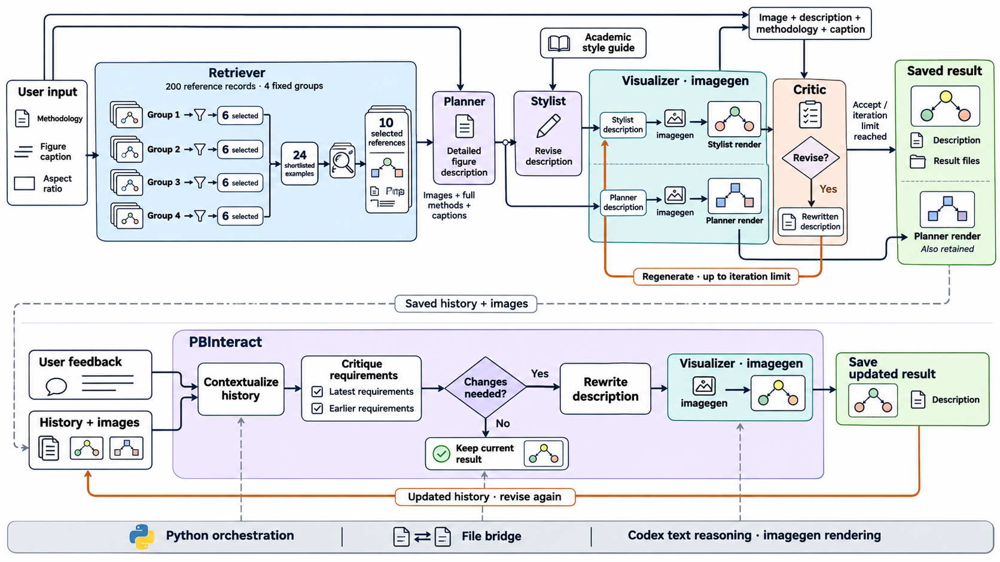

# PaperSketch

**PaperBanana-Interact의 논문 그림 생성·반복 수정 과정을 Codex에서 실행하기 위한 로컬 스킬 프로젝트임.** 방법론과 캡션을 입력받아 참고 예제를 선택하고, 그림을 설계·생성·검토한 뒤 사용자 피드백을 반영하는 흐름으로 구성됨.

PaperBanana 계열의 실제 Python 에이전트·프롬프트·처리 순서를 이식 기준으로 사용함. 텍스트 추론은 Codex, 이미지 생성은 내장 imagegen으로 연결하며, 검색 입력 크기에 대응하기 위해 단계 검색을 적용함.

## Framework



### 최초 그림 생성

```text
방법론 + 캡션 + 그림 비율
  → Retriever: 고정 후보 200개를 4그룹으로 비교
      → 그룹당 6개 선택 → 24개 전문 재비교 → 최종 10개 선택
  → Planner: 참고 그림·본문·캡션을 활용한 상세 설계
  → Stylist: 학술 그림 스타일 가이드 적용
  → Visualizer: Planner 설명과 Stylist 설명을 각각 렌더링
  → Critic: Stylist 그림부터 검토 → 필요 시 설명 수정·재생성
  → 선택 결과와 중간 버전 저장
```

| 단계 | 역할 | 다음 단계로 전달하는 결과 |
|---|---|---|
| Retriever | 앞 200개 참고 자료의 전체 본문·캡션을 4개 고정 그룹으로 비교하고 최종 예제 선택 | 참고 ID 10개 |
| Planner | 사용자 요청과 선택된 실제 그림 10개·전체 본문·캡션으로 구성·연결·배치 설계 | 상세 그림 설명 |
| Stylist | 원본 학술 스타일 가이드를 바탕으로 설명 보완 | 스타일을 반영한 설명 |
| Visualizer | 설명을 내장 imagegen에 전달하고 결과를 원본 이미지 계약으로 변환 | 초기 그림 2개 및 후속 수정 그림 |
| Critic | 그림·상세 설명·방법론·캡션을 대조하고 수정 필요성 검토 | 수정 설명 또는 무변경 판단 |

- Critic은 수정이 필요 없거나 반복 상한에 도달하면 종료함. 초기 검토 상한의 기본값은 3회임.
- 원본 정책상 마지막 허용 반복에서 재생성한 그림은 추가 검토 없이 선택될 수 있음.
- auto는 본문·캡션으로 예제를 선택함. 실제 참고 이미지는 선택 이후 Planner 입력에 포함됨.

### 사용자 피드백과 반복 수정

```text
선택 그림 + 설명 + 이전 요청·그림 이력 + 새 피드백
  → PBInteract: 이력 문맥화
  → 최신 요구·이전 요구 각각에 대한 그림 검토
  → 수정 필요 판단
      ├─ NO: 현재 결과 유지
      └─ YES: 기존 상세 설명을 제공하고 설명 재작성
                 → Visualizer로 새 그림 생성
                 → 설정한 내부 반복 범위에서 재검토
  → 새 결과 폴더에 저장 → 다음 피드백으로 이어가기
```

- PBInteract는 Interact에 포함된 수정 에이전트임. 검토 요청에는 현재 렌더링 상세 설명을 제외하고, 수정이 필요할 때 설명 재작성 요청에 추가함.
- 수정은 설명 기반 재생성 방식임. 기존 그림을 픽셀 단위로 편집하는 경로와 구분됨.
- 피드백 단계에서는 참고 예제를 다시 검색하지 않고 기존 결과와 이력을 사용함.
- 결과를 새 폴더에 저장하여 이전 버전을 보존함. 과거 결과에서 분기하거나 현재 턴의 다른 버전을 선택하는 기능도 제공됨.

## 원본 프로젝트와 이식 범위

| 프로젝트 | 역할 | 분석·보존 기준 커밋 |
|---|---|---|
| [PaperBanana-Interact](https://github.com/shirley-wu/PaperBanana-Interact) | 최초 생성과 PBInteract 반복 수정의 주 이식 기준 | `ed08ef7e427ce147194af91d8ae6326a6cbc9cbd` |
| [PaperBanana](https://github.com/dwzhu-pku/PaperBanana) | 에이전트·실행기 차이 및 기존 스킬 구성의 보조 참고 | `f1da3db8d5f4c3add947dfd3ddd93dddd3394dc3` |
| [PaperVizAgent](https://github.com/google-research/papervizagent) | 초기 구현과 공통 처리 흐름의 비교 기준 | `e088a8fff74cc363b6897c0843631fff76484908` |

보존된 Interact 파일 30개의 출처·커밋·SHA-256은 [SOURCE_MANIFEST.json](skills/paper-sketch/assets/interact/SOURCE_MANIFEST.json)에 기록됨. 해당 코드의 Apache-2.0 라이선스와 저작권 표시는 [원본 LICENSE](skills/paper-sketch/assets/interact/LICENSE) 및 각 파일에 유지됨. 참고 논문·그림의 권리는 원 출처 확인이 필요함.

| 구분 | PaperSketch의 적용 방식 |
|---|---|
| 원본 재사용 | Planner·Stylist·Visualizer·Critic·PBInteract·processor, 스타일 가이드와 상태 필드 재사용 |
| 모델 연결 변경 | 원본 provider 호출 경계를 파일 bridge로 교체하고 Codex·내장 imagegen에 연결 |
| 검색 방식 변경 | 200개 일괄 비교를 4그룹×6개 → 24개 → 최종 10개 방식으로 변경. 원본 관련성 기준과 후보 전문 유지 |
| 저장·재개 추가 | 상대 이미지 blob 경로, 버전 목록, 결과 조회·선택·비파괴 분기 제공 |
| 현재 실행 범위 | 단일 후보 diagram, PBInteract 수정, 완료 결과 재개 |

plot·동시 다중 후보·다른 refiner·원본 UI 세션의 임의 가져오기·중단 실행 복구는 현재 연결 범위에 포함되지 않음. 원본의 모든 기능이나 생성 성능을 그대로 재현했다는 의미는 아님.

## 실행 환경과 사용법

- 실제 실행 지침: [영어 SKILL.md](skills/paper-sketch/SKILL.md)임.
- 한국어 설명: [한국어 검토본](review/SKILL.ko.md)임. 실행 코드와 영어 스킬은 한국어 검토본을 참조하지 않음.
- Python 3.11에서 검증됨. 원본 권장 버전은 Python 3.12임.
- Python 의존성: [requirements.txt](skills/paper-sketch/scripts/requirements.txt)임. Google SDK는 원본 메시지·설정 타입에 사용됨.
- 그룹 검색에는 기존 ChatGPT 인증으로 로그인된 Codex CLI가 필요하며, 이미지 생성에는 Codex의 내장 imagegen 도구가 필요함.
- 원본 Gemini/OpenRouter 등의 API 키는 이식 경로에 필요하지 않음. 실제 Codex·이미지 도구 사용량은 발생함.

Python 실행기는 요청 파일을 작성하고 응답을 기다림. **활성 Codex가 스킬 지침에 따라 요청을 처리해야 하며, Python 명령 단독으로 전체 그림 생성이 자동 완료되는 구조는 아님.** 그룹 검색은 별도 제공하는 응답 명령으로 독립 Codex 문맥에서 처리함.

### 데이터 준비

| 로컬 경로 | 용도 |
|---|---|
| `data/MTPaperBananaBench/` | [MTPaperBananaBench](https://huggingface.co/datasets/xqwu/MTPaperBananaBench) 원본 |
| `data/prepared/MTPaperBananaBench/` | 이미지 경로를 검증·보정한 실행용 사본 |
| `data/derived/MTPaperBananaBench/retrieval-first200-800k/` | 앞 200개를 전문 그대로 분할한 고정 4그룹 |
| `data/PaperBananaBench/` | 보조 비교용 [PaperBananaBench](https://huggingface.co/datasets/dwzhu/PaperBananaBench) |

- ref는 참고 예제, test는 평가용 데이터임. 현재 생성 경로는 MTP의 ref를 사용함.
- 원본 MTP의 ref_309 경로에 있는 선두 U+200C 불일치는 실행용 사본에서만 보정함. 원본 데이터는 보존함.
- 데이터셋과 고정 그룹 파일은 Git에 포함되지 않음. 최초 체크아웃에는 별도 데이터 준비가 필요함.
- 고정 그룹의 구성·hash·크기는 [그룹 분할 보고서](review/RETRIEVAL_GROUPS_2026-11-03.ko.md)에 기록됨. 그룹 생성 작업 코드는 로컬 실행 기록에 있으며 아직 스킬의 배포용 준비 명령으로 포함되지 않았음.

### 생성·수정·재개

방법론과 캡션은 다음 형식의 UTF-8 JSON으로 입력함. additional_info 생략 시 비율 기본값은 21:9임.

```json
{
  "content": "그림으로 표현할 방법론",
  "visual_intent": "그림 캡션과 표현 의도",
  "additional_info": { "rounded_ratio": "21:9" }
}
```

아래 명령은 프로젝트 루트에서 실행하는 예시임. 격리 Python 환경의 의존성 설치와 데이터·그룹 준비가 선행되어야 함.

```powershell
# 최초 생성: input.json을 미리 준비한 뒤 실행
python skills/paper-sketch/scripts/run.py generate --input input.json --dataset-dir data/prepared/MTPaperBananaBench --reference-groups data/derived/MTPaperBananaBench/retrieval-first200-800k --output runs/example-initial --retrieval auto --critic-rounds 3

# 저장 결과 조회
python skills/paper-sketch/scripts/run.py inspect --prior runs/example-initial/result.json

# 사용자 피드백 수정: feedback.txt를 미리 준비한 뒤 실행
python skills/paper-sketch/scripts/run.py refine --prior runs/example-initial/result.json --feedback-file feedback.txt --dataset-dir data/prepared/MTPaperBananaBench --output runs/example-refined --internal-rounds 2
```

- 모든 출력은 새 폴더를 지정함. 그룹 검색 요청 제출·전체 host 처리·버전 선택 절차는 영어 스킬에 정의됨.
- result.json은 설명·선택·이력, retrieval.json은 단계별 검색 결과, state.json은 버전·출처 정보를 보존함.
- images/·final.jpg·description.txt는 확인용 결과이며 base64/는 재개용 이미지 데이터임. 이동 시 실행 폴더 전체를 보존할 필요가 있음.

## 검증 상태

- 오프라인 회귀 테스트 23개 통과 기록이 있음.
- 단계 검색은 합성 요청 5종에서 25회 실제 Codex 호출이 모두 완료됨. 선택된 참고 이미지 50건의 원본 Planner 요청 연결도 확인됨.
- 본 README 그림은 실제 PaperSketch 생성 경로와 PBInteract 수정 경로를 통해 제작됨. 요청·응답·중간 결과는 로컬 runs/에 보존됨.
- 원본 대비 정량 품질, 선택의 최적성, 전체 검색 반복 안정성은 아직 검증되지 않았음.
- PBInteract 등 검색 이외 단계의 문맥 격리, 생성 실패 시 원본 fallback, blob 내용 hash 재검증 등에 남은 항목이 있음.
- 기본 비율은 21:9이나 내장 이미지 도구의 정확한 출력 비율을 강제하지 못함. 위 그림의 실제 크기는 1672×941px임.

상세 근거는 [단계 검색 구현·실제 시험 보고서](review/GROUPED_RETRIEVAL_IMPLEMENTATION_AND_TEST_2026-11-03.ko.md), [이식 충실성 검증](review/FIDELITY_REVIEW_2026-11-03.ko.md), [검증항목.md](검증항목.md)에 정리됨. 과거 보고서는 작성 당시의 상태이며 이후 변경은 최신 보고서와 실행 지침을 기준으로 확인할 필요가 있음.

## 프로젝트 구성

```text
PaperSketch/
├── skills/paper-sketch/       # 영어 스킬, 실행기, 보존된 Interact 코드
├── docs/images/              # README 프레임워크 이미지
├── review/                   # 한국어 검토본과 분석·검증 보고서
├── tests/                    # 데이터·호출·저장·재개 테스트
├── data/                     # 로컬 데이터셋·고정 참고 그룹, Git 제외
├── runs/                     # 로컬 생성·수정·검증 기록, Git 제외
├── reference/                # 독립적인 원본 저장소, Git 제외
├── ANALYSIS_AND_PORT_PLAN.md # 원본 분석과 이식 계획
└── 검증항목.md               # 현재 점검 목록
```

- .venv/·__pycache__/·*.pyc도 Git 추적에서 제외됨.
- 원본 소스·프롬프트·데이터 출처와 라이선스 검토 내용은 [분석·이식 계획](ANALYSIS_AND_PORT_PLAN.md)에 기록됨.
